# Apache Kafka — Plateforme distribuée de streaming d'événements

## Mise en œuvre d'un système de publication/abonnement temps réel : « ShopStream », bus d'événements de commandes e-commerce

*Projet Big Data — Master Génie Logiciel*

---

## Note préliminaire : choix du sujet et lecture du canevas

**Sujet retenu : n°6 — Apache Kafka (Système de Publication/Abonnement).**

Justification du choix :

1. **Richesse architecturale.** Kafka mobilise à lui seul la plupart des concepts fondamentaux des systèmes distribués : partitionnement, réplication par leader/suiveurs, consensus (protocole Raft via KRaft), sémantiques de livraison (*at-most-once*, *at-least-once*, *exactly-once*), coordination de groupes et rééquilibrage, gestion d'offsets, rétention et compaction de journaux.
2. **Position centrale dans l'écosystème.** Kafka est la colonne vertébrale d'ingestion de la plupart des architectures Big Data modernes : il alimente Spark Streaming, Flink, Storm, Hive/HDFS (via Kafka Connect), Cassandra, Elasticsearch, etc. Le maîtriser éclaire donc les autres sujets du PDF (Flume, Storm, Spark Streaming).
3. **Démonstrabilité.** Les propriétés annoncées (débit, tolérance aux pannes, scalabilité horizontale, rejouabilité) peuvent être **prouvées expérimentalement** sur un poste de travail grâce à un cluster Docker de 3 nœuds, ce qui donne une partie pratique mesurable et non un simple « Hello World ».

Le document suit strictement le canevas exigé :

- **Partie 1 — Théorique** : Contexte · Problématique · Objectif · Principe de fonctionnement (avec schéma) · Architecture du système (avec schéma).
- **Partie 2 — Pratique** : cas d'usage, environnement, étapes pas à pas, scripts complets, schémas, emplacements de captures d'écran, analyse des résultats, limites et bonnes pratiques, conclusion générale.

> **Point à valider avec l'enseignant (non bloquant).** L'application illustrative du PDF se limite à « configurer un topic, produire et consommer des messages ». Le cas pratique proposé ici **conserve exactement cette logique** (topics, producteurs, consommateurs), mais l'étend à un scénario métier réaliste (plusieurs services abonnés, tolérance aux pannes, montée en charge, rejouabilité, mesure de performance). Si un périmètre strictement minimal est attendu, les étapes 1 à 4 de la partie pratique suffisent à couvrir l'énoncé.

**Choix d'environnement figés (pour la reproductibilité) :**

| Élément | Choix |
|---|---|
| Système hôte | Windows 10/11, macOS ou Linux, avec Docker Desktop (≥ 4 Go de RAM alloués à Docker) |
| Kafka | **Apache Kafka 4.0.0**, image officielle `apache/kafka:4.0.0`, mode **KRaft** (sans ZooKeeper) |
| Topologie | Cluster de **3 nœuds** (broker + contrôleur combinés) via Docker Compose |
| Supervision | **Kafka UI** (`kafbat/kafka-ui:v1.0.0`) sur http://localhost:8080 |
| Clients | **Python 3.11+** avec la bibliothèque `confluent-kafka` (≥ 2.6, basée sur librdkafka) |

Le code source, les configurations et les scripts ne sont pas reproduits dans ce document : ils sont publiés sur le dépôt **https://github.com/Ayib201/presentation-bigData** (dossier `kafka-shopstream/`), auquel le rapport renvoie (voir § 7.2).

Toutes les manipulations de la partie pratique ont été **exécutées et validées** sur la machine de l'auteur le 22-23 novembre 2026 (Windows 11, Docker Desktop avec 8 Go de RAM, Python 3.13, `confluent-kafka` 2.16) ; les valeurs mesurées sont reportées au § 9.1.

---

# PARTIE 1 : THÉORIQUE

## 1. Contexte

### 1.1 De la donnée « au repos » à la donnée « en mouvement »

Les systèmes d'information ont longtemps été conçus autour d'une base de données centrale : les applications écrivent un état, et les traitements analytiques sont exécutés **a posteriori**, par lots (*batch*), souvent la nuit, via des chaînes ETL vers un entrepôt de données. Ce modèle, cohérent avec l'écosystème Hadoop de première génération (HDFS + MapReduce, puis Hive et Pig), considère la donnée comme **au repos**.

Or une part croissante de la valeur métier dépend de la **réactivité** : détecter une fraude avant l'expédition d'une commande, ajuster un stock en temps réel, alerter sur un capteur IoT défaillant, personnaliser une recommandation pendant la session de l'utilisateur. La donnée doit alors être traitée **en mouvement**, sous la forme d'un **flux continu d'événements** (« une commande a été créée », « un paiement a été validé », « une température a été mesurée »).

### 1.2 Les limites des approches traditionnelles

| Approche | Fonctionnement | Limites face au Big Data temps réel |
|---|---|---|
| **Intégration point à point** (appels REST/RPC directs, fichiers échangés) | Chaque producteur appelle chaque consommateur | Couplage fort ; complexité en O(n × m) connexions ; une panne d'un consommateur bloque ou fait perdre des données au producteur ; pas de rejeu possible |
| **ETL batch** vers entrepôt | Extraction périodique, transformation, chargement | Latence de plusieurs heures ; pics de charge ; données périmées au moment de l'analyse |
| **Files de messages classiques** (JMS, ActiveMQ, RabbitMQ en mode file) | Le broker pousse le message puis le **supprime** après acquittement | Le message n'est lu qu'une fois par file ; pas de relecture historique ; le débit s'effondre quand les messages s'accumulent (stockage en mémoire, index par message) ; mise à l'échelle horizontale limitée |
| **Base de données comme bus** (tables « outbox » interrogées en boucle) | Les consommateurs scrutent une table | Polling coûteux, contention sur la base, latence, mauvaise scalabilité |

Le diagramme ci-dessous illustre l'« architecture spaghetti » typique de l'intégration point à point, que Kafka remplace par un **bus central** :

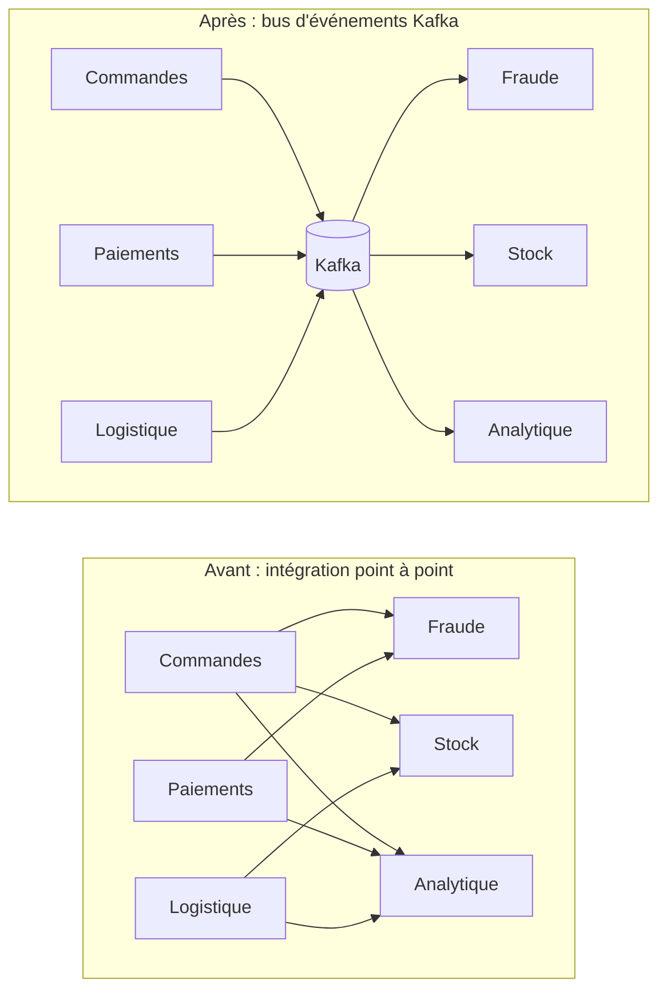

### 1.3 Apache Kafka dans l'écosystème Big Data

Apache Kafka, conçu à LinkedIn (2010) puis confié à la fondation Apache (2011), est une **plateforme distribuée de streaming d'événements**. Il combine trois capacités :

1. **Publier et s'abonner** à des flux d'enregistrements (rôle de bus de messages) ;
2. **Stocker durablement** ces flux, de manière répliquée et tolérante aux pannes, pendant une durée configurable (rôle de journal distribué) ;
3. **Traiter** les flux au fil de l'eau (Kafka Streams, ou moteurs externes : Spark Structured Streaming, Flink, Storm).

Dans une architecture Big Data, Kafka occupe la **couche d'ingestion et de transport** : il découple les sources (applications, bases via CDC, capteurs, journaux applicatifs — rôle comparable à Flume) des puits (HDFS/Hive, Cassandra, moteurs de streaming, moteurs de recherche). Il est au cœur des architectures **Lambda** et **Kappa**, ainsi que des architectures orientées événements (*Event-Driven Architecture*, microservices, *event sourcing*, CQRS).

Depuis la version **4.0 (2025)**, Kafka fonctionne exclusivement en mode **KRaft** : la gestion des métadonnées, auparavant déléguée à Apache ZooKeeper, est assurée par un quorum interne de contrôleurs utilisant le protocole de consensus Raft. Cela simplifie le déploiement et augmente le nombre de partitions gérables par cluster.

### 1.4 Besoins métiers et techniques actuels

- **Métier** : réactivité (détection de fraude, alerting), vision client unifiée, traçabilité/audit (rejouer l'historique), découplage des équipes (chaque équipe consomme le flux sans dépendre des autres).
- **Technique** : débits de centaines de milliers à millions d'événements par seconde, latence de bout en bout de l'ordre de la dizaine de millisecondes, absence de perte de données, scalabilité horizontale, ordre garanti là où il compte (par client, par compte, par capteur), intégration native avec l'écosystème (connecteurs, moteurs de streaming).

---

## 2. Problématique

Le contexte fait émerger la question centrale suivante :

> **Comment concevoir une infrastructure de transport d'événements capable d'absorber des flux massifs et continus avec une faible latence, sans perte ni désordre préjudiciable, résistante aux pannes de serveurs, extensible horizontalement, et permettant à un nombre arbitraire de systèmes consommateurs de traiter — et retraiter — ces flux indépendamment les uns des autres ?**

Cette question se décompose en défis techniques précis :

| Défi | Formulation | Tension sous-jacente |
|---|---|---|
| **Débit** | Absorber 10⁵ à 10⁶ msg/s par cluster | Chaque écriture disque/réseau individuelle coûte cher → nécessité de traitement par lots, compression, E/S séquentielles |
| **Latence** | Livrer un événement en quelques ms à dizaines de ms | Le *batching* qui améliore le débit **augmente** la latence (compromis `linger.ms`) |
| **Volumétrie** | Conserver des jours/semaines de flux (To) | Un stockage en mémoire n'est pas viable ; il faut un stockage disque performant |
| **Tolérance aux pannes** | Survivre à la perte d'un ou plusieurs serveurs sans perte de données acquittées | Réplication synchrone = sûreté mais latence ; asynchrone = rapidité mais risque de perte |
| **Cohérence et ordre** | Garantir l'ordre des événements d'une même entité ; éviter doublons et pertes | Ordre global incompatible avec le parallélisme ; les rejeux réseau créent des doublons |
| **Scalabilité** | Augmenter la capacité en ajoutant des machines, côté stockage **et** côté traitement | Il faut une unité de parallélisme qui préserve l'ordre local |
| **Découplage et rejouabilité** | Plusieurs consommateurs à des rythmes différents ; possibilité de relire le passé | Une file classique supprime le message après lecture |
| **Intégration** | S'insérer dans l'écosystème existant (bases, HDFS, Spark, microservices) | Hétérogénéité des formats et des protocoles |

Le théorème **CAP** rappelle par ailleurs qu'en présence de partition réseau, il faut arbitrer entre cohérence et disponibilité. Kafka rend cet arbitrage **configurable** (paramètres `acks`, `min.insync.replicas`, `unclean.leader.election.enable`), ce qui est au cœur de la démonstration pratique.

---

## 3. Objectif

### 3.1 Objectif général

Étudier en profondeur le fonctionnement interne d'Apache Kafka et **démontrer expérimentalement**, sur un cluster distribué, sa capacité à servir de bus d'événements fiable, performant et extensible pour une application métier réaliste de publication/abonnement.

### 3.2 Objectifs spécifiques

**Sur le plan théorique :**

1. Expliquer le modèle de données de Kafka (topic, partition, offset, segment) et la notion de **journal distribué en ajout seul** (*append-only commit log*).
2. Expliquer les mécanismes de **réplication** (leader, suiveurs, ISR, *high watermark*) et de **consensus** des métadonnées (KRaft).
3. Expliquer les **sémantiques de livraison** et les mécanismes qui les permettent (acquittements, producteur idempotent, transactions, validation des offsets).
4. Expliquer la **coordination des groupes de consommateurs** et le rééquilibrage.

**Sur le plan pratique :**

1. Déployer un cluster Kafka **3 nœuds en mode KRaft** reproductible (Docker Compose) avec un outil de supervision.
2. Concevoir et créer des topics dimensionnés (partitions, facteur de réplication, rétention, `min.insync.replicas`).
3. Développer un **producteur** métier fiable (idempotent, `acks=all`, compression, clé de partitionnement).
4. Développer **deux services consommateurs indépendants** (détection de fraude, analytique temps réel) illustrant le modèle publication/abonnement (*fan-out*), avec gestion des messages invalides (**Dead Letter Queue**).
5. Démontrer la **scalabilité horizontale** (ajout d'instances, rééquilibrage des partitions, suivi du *lag*).
6. Démontrer la **tolérance aux pannes** (arrêt de brokers, réélection de leader, comportement face à `min.insync.replicas`).
7. Démontrer la **rejouabilité** (réinitialisation des offsets d'un groupe).
8. **Mesurer** les performances (débit, latence) et analyser l'impact des paramètres de durabilité.

---

## 4. Principe de fonctionnement

### 4.1 Vue d'ensemble des composants

| Composant | Rôle |
|---|---|
| **Producer** (producteur) | Application cliente qui publie des enregistrements dans un topic |
| **Consumer** (consommateur) | Application cliente qui lit des enregistrements ; appartient à un **groupe de consommateurs** |
| **Broker** | Serveur Kafka qui stocke les partitions et sert les requêtes des clients |
| **Controller** (KRaft) | Nœud membre du quorum Raft qui gère les métadonnées du cluster (topics, partitions, leaders, ISR, configuration) |
| **Topic** | Catégorie logique de flux (ex. `orders.created`) |
| **Partition** | Sous-division d'un topic : journal ordonné, immuable, en ajout seul ; **unité de parallélisme et de réplication** |
| **Offset** | Position (entier croissant) d'un enregistrement dans une partition |
| **Record** (enregistrement) | Clé (optionnelle) + valeur (octets) + horodatage + en-têtes |
| **Consumer group** | Ensemble de consommateurs se partageant les partitions d'un topic ; chaque partition est lue par **un seul** membre du groupe |
| **Group coordinator** | Broker chargé de gérer l'appartenance d'un groupe et ses offsets validés (topic interne `__consumer_offsets`) |

### 4.2 Le journal distribué : topics, partitions, offsets

Un topic est découpé en **N partitions**. Chaque partition est un **journal en ajout seul** : un nouvel enregistrement est toujours écrit à la fin et reçoit l'offset suivant. Les enregistrements ne sont **jamais modifiés** et ne sont **pas supprimés à la lecture** : ils sont conservés selon une politique de **rétention** (durée `retention.ms`, taille `retention.bytes`) ou de **compaction** (conservation de la dernière valeur par clé).

Physiquement, une partition est un répertoire contenant des **segments** (fichiers `.log` de 1 Go par défaut) accompagnés d'index (`.index` offset → position, `.timeindex` horodatage → offset). La rétention s'applique par suppression de segments entiers, opération très peu coûteuse.

```
Topic orders.created (6 partitions)

Partition 0 : | 0 | 1 | 2 | 3 | 4 | 5 | 6 | 7 |  ← écritures (append)
Partition 1 : | 0 | 1 | 2 | 3 | 4 |               ← écritures
Partition 2 : | 0 | 1 | 2 | 3 | 4 | 5 | 6 |       ← écritures
   ...                    ▲               ▲
                          │               └── offset du groupe "analytics"
                          └── offset du groupe "fraud-detection"
  (chaque groupe lit à son propre rythme ; les données restent disponibles)
```

**Choix de la partition.** Le producteur détermine la partition cible :

- si une **clé** est fournie : `partition = murmur2(clé) mod N` → tous les messages d'une même clé (ex. un client) vont dans la même partition, ce qui **garantit leur ordre** ;
- sans clé : partitionnement « collant » (*sticky*) qui remplit un lot vers une partition avant de passer à la suivante.

> **Garantie d'ordre** : Kafka garantit l'ordre **à l'intérieur d'une partition**, pas entre partitions. Le choix de la clé est donc une décision de conception essentielle.

**Pourquoi c'est rapide.** Kafka tire ses performances de choix d'ingénierie système :

- **E/S séquentielles** sur disque (ajout en fin de fichier), bien plus rapides que les accès aléatoires ;
- usage intensif du **cache de pages** de l'OS plutôt que d'un cache applicatif ;
- **zero-copy** (`sendfile`) : les données passent du cache de pages à la socket réseau sans recopie en espace utilisateur ;
- **traitement par lots** de bout en bout (le producteur envoie des lots, le broker les écrit tels quels, le consommateur les lit en lots) ;
- **compression par lot** (lz4, zstd, snappy, gzip) ;
- modèle **pull** : le consommateur tire les données à son rythme, ce qui évite de saturer les consommateurs lents.

### 4.3 Réplication, ISR et tolérance aux pannes

Chaque partition est répliquée sur **RF** brokers (*replication factor*). Parmi les répliques :

- une est **leader** : elle reçoit toutes les écritures et (par défaut) toutes les lectures ;
- les autres sont **suiveuses** (*followers*) : elles récupèrent les données du leader en continu (requêtes *fetch*).

L'**ISR** (*In-Sync Replicas*) est l'ensemble des répliques suffisamment à jour (ayant rattrapé le leader depuis moins de `replica.lag.time.max.ms`, 30 s par défaut). Le **high watermark** (HW) est l'offset jusqu'auquel tous les membres de l'ISR ont répliqué ; **seuls les messages en dessous du HW sont visibles par les consommateurs** — ce qui garantit qu'un consommateur ne lira jamais un message susceptible d'être perdu lors d'un changement de leader.

Le niveau de durabilité est fixé par le producteur via **`acks`** :

| `acks` | Le leader répond quand… | Risque | Performance |
|---|---|---|---|
| `0` | sans attendre (aucun accusé) | perte possible sans le savoir | maximale |
| `1` | il a écrit localement | perte si le leader tombe avant réplication | élevée |
| `all` (`-1`) | **toutes les répliques de l'ISR** ont écrit | aucune perte tant qu'il reste une réplique ISR | plus faible |

Combiné à `min.insync.replicas = 2` (avec RF = 3), `acks=all` impose qu'**au moins 2 copies** existent avant acquittement. Si l'ISR tombe sous ce seuil, le broker **refuse les écritures** (`NotEnoughReplicas`) : Kafka choisit alors la **cohérence** plutôt que la disponibilité en écriture.

Le diagramme de séquence suivant décrit une écriture `acks=all` :

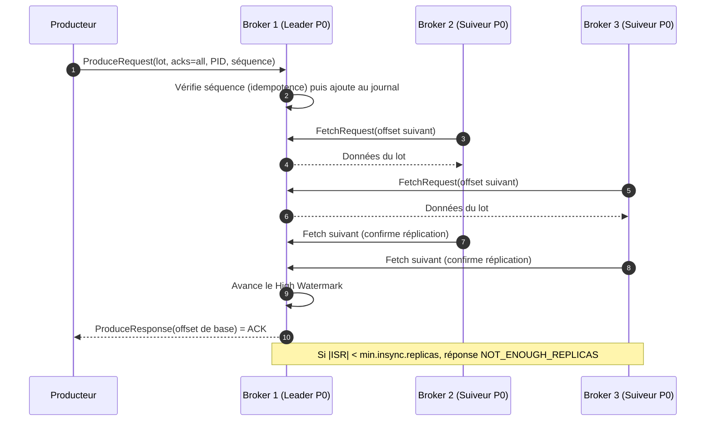

**En cas de panne d'un broker**, le contrôleur actif du quorum KRaft détecte la perte (absence de *heartbeat*), choisit un nouveau leader **parmi l'ISR** pour chaque partition concernée, et publie la nouvelle métadonnée. Les clients, en recevant une erreur `NOT_LEADER_OR_FOLLOWER`, rafraîchissent leurs métadonnées et redirigent leurs requêtes : la bascule est **automatique et transparente** (quelques secondes au plus). Lorsque le broker revient, ses répliques rattrapent leur retard puis réintègrent l'ISR.

### 4.4 KRaft : la gestion des métadonnées par consensus Raft

Les métadonnées du cluster sont stockées dans un journal interne répliqué, `__cluster_metadata`, géré par un **quorum de contrôleurs** (3 dans notre cas) selon le protocole **Raft** :

- un contrôleur est élu **leader actif** (majorité requise : 2 sur 3) ;
- chaque changement (création de topic, changement de leader, modification d'ISR) est un enregistrement ajouté à ce journal ;
- les brokers suivent ce journal et appliquent les changements localement.

Un quorum de 3 contrôleurs tolère **1 panne** ; un quorum de 5 en tolère 2. Notre déploiement en mode combiné (chaque nœud est à la fois broker et contrôleur) est adapté au développement ; en production, les contrôleurs sont isolés sur des nœuds dédiés.

### 4.5 Producteur : batching, idempotence, transactions

Le producteur accumule les enregistrements dans des **lots par partition** (`batch.size`) et attend au plus `linger.ms` avant l'envoi. Il peut compresser chaque lot.

Le **producteur idempotent** (`enable.idempotence=true`, activé par défaut dans les clients récents) reçoit un identifiant **PID** et numérote chaque lot (**numéro de séquence** par partition). Si un lot est renvoyé suite à un délai réseau, le broker détecte le doublon grâce au couple (PID, séquence) et l'ignore : on obtient **exactement une écriture par partition**, sans doublon ni réordonnancement, même avec des tentatives multiples.

Les **transactions** (`transactional.id`) étendent cette garantie à l'écriture atomique sur plusieurs partitions **et** à la validation des offsets de consommation dans la même transaction (motif *consume-transform-produce*), ce qui fonde la sémantique **exactly-once** au sein de Kafka.

### 4.6 Consommateurs, groupes, offsets et rééquilibrage

Un consommateur s'abonne à un ou plusieurs topics en déclarant un **`group.id`**. Le coordinateur de groupe attribue les partitions aux membres :

- au sein d'un groupe, **une partition est lue par un seul membre** → c'est le modèle **file de messages** (répartition de charge) ;
- deux groupes différents lisent **chacun la totalité** du flux → c'est le modèle **publication/abonnement** (diffusion) ;
- le parallélisme maximal d'un groupe est égal au **nombre de partitions** (les membres excédentaires restent inactifs).

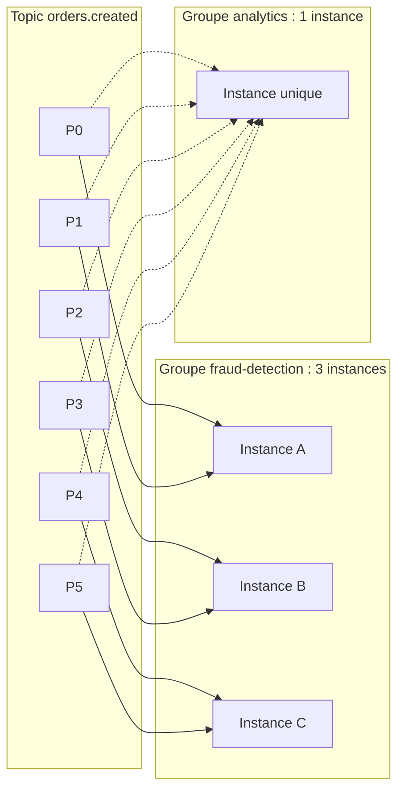

**Offsets validés.** Chaque groupe enregistre, par partition, l'offset du prochain message à lire dans le topic interne compacté `__consumer_offsets`. Le moment de cette validation (*commit*) détermine la sémantique :

| Moment du commit | Sémantique | Conséquence en cas de crash |
|---|---|---|
| Avant le traitement | *at-most-once* | messages perdus (jamais traités) |
| **Après le traitement** | ***at-least-once*** | messages retraités (doublons possibles → traitement idempotent conseillé) |
| Dans une transaction avec les sorties | *exactly-once* | ni perte ni doublon (au sein de Kafka) |

**Rééquilibrage (*rebalance*).** Lorsqu'un membre rejoint ou quitte le groupe (ou cesse d'envoyer ses *heartbeats* pendant `session.timeout.ms`), les partitions sont redistribuées. Le protocole **coopératif incrémental** (`cooperative-sticky`) ne révoque que les partitions qui doivent changer de propriétaire, sans interrompre tout le groupe (contrairement au protocole « eager » historique). Kafka 4.0 introduit en outre un nouveau protocole de groupe côté serveur (KIP-848) qui confie entièrement le calcul d'affectation au coordinateur.

**Lag.** La différence entre le dernier offset du journal (*log end offset*) et l'offset validé d'un groupe est le **lag** : c'est l'indicateur clé de santé d'un consommateur.

### 4.7 Schéma de synthèse du principe de fonctionnement

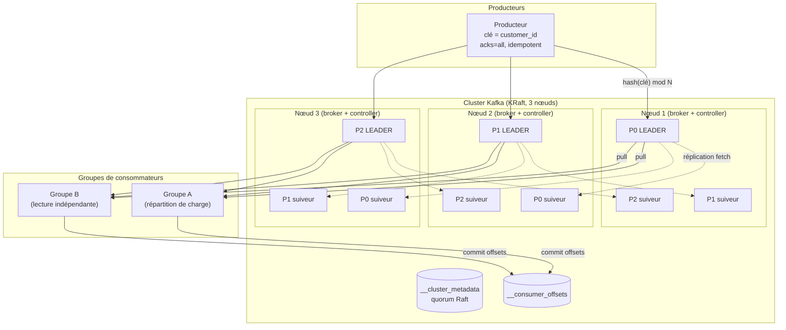

---

## 5. Architecture du système proposé

### 5.1 Présentation : la plateforme « ShopStream »

ShopStream est le bus d'événements d'une plateforme de commerce en ligne fictive opérant dans plusieurs pays francophones. Chaque commande créée par le service « Commandes » est publiée sous forme d'événement `OrderCreated`. Plusieurs services s'y abonnent **indépendamment** :

- le **service de détection de fraude** évalue chaque commande en temps réel et publie des alertes ;
- le **service d'analytique** calcule en continu le chiffre d'affaires par fenêtre de temps, catégorie et pays ;
- d'autres abonnés (notification, entrepôt de données, stock) peuvent être ajoutés **sans modifier** le producteur.

### 5.2 Architecture en couches

| Couche | Composants | Responsabilité |
|---|---|---|
| **Sources / Ingestion** | Service Commandes (`order_producer.py`) ; à terme : CDC (Debezium), Kafka Connect | Produire des événements fiables, clés de partitionnement métier |
| **Transport / Stockage (broker)** | Cluster Kafka 3 nœuds KRaft ; topics `orders.created`, `orders.fraud-alerts`, `orders.dlq` | Persistance répliquée, ordre par clé, rétention, découplage |
| **Traitement** | `fraud_detector.py` (groupe `fraud-detection`, N instances) ; `revenue_analytics.py` (groupe `analytics`) | Règles métier, agrégations fenêtrées, routage des erreurs |
| **Consommation / Restitution** | Topic d'alertes (consommé par un service de notification / console) ; rapport `revenue_report.csv` ; extension : HDFS/Hive, Cassandra, tableau de bord | Mise à disposition des résultats |
| **Supervision / Observabilité** | Kafka UI (brokers, topics, partitions, ISR, groupes, lag) ; outils CLI ; extension : JMX → Prometheus → Grafana | Santé du cluster, lag, débit |

### 5.3 Schéma d'architecture

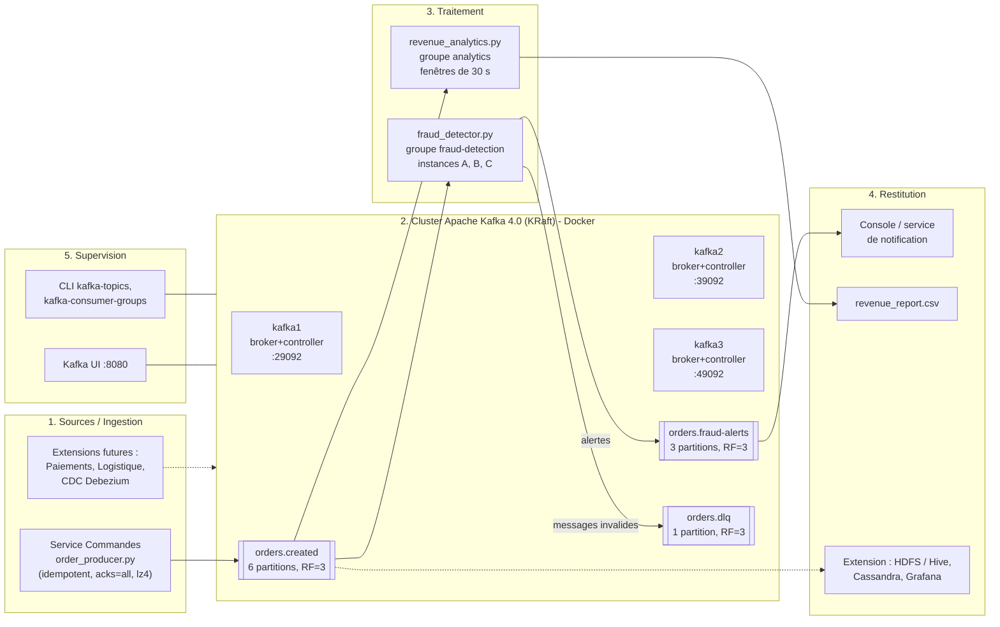

### 5.4 Décisions de conception justifiées

| Décision | Justification |
|---|---|
| **3 nœuds, RF = 3, `min.insync.replicas` = 2** | Tolère la panne d'un broker **sans perte et sans interruption** des écritures ; configuration standard de production |
| **6 partitions** pour `orders.created` | Permet jusqu'à 6 consommateurs parallèles par groupe ; multiple de 2 et 3 → répartition équilibrée avec 2 ou 3 instances |
| **Clé = `customer_id`** | Ordre garanti par client ; indispensable à la règle de vélocité (toutes les commandes d'un client sont vues par la même instance) |
| **Producteur idempotent + `acks=all`** | Aucune perte de message acquitté, aucun doublon dû aux tentatives |
| **Commit manuel après traitement** (fraude) | Sémantique *at-least-once* : aucune commande n'échappe à l'analyse, même en cas de crash |
| **Dead Letter Queue** | Un message corrompu (« poison pill ») ne bloque pas la partition ; il est isolé avec son contexte (en-têtes) pour analyse |
| **`auto.create.topics.enable=false`** | Gouvernance : les topics sont dimensionnés explicitement, pas créés par erreur de frappe |
| **Assignation `cooperative-sticky`** | Rééquilibrages incrémentaux, sans interruption globale du groupe |
| **Rétention 7 jours** (commandes) | Permet le rejeu d'une semaine d'historique (correction de bug, nouveau service) |

---

# PARTIE 2 : PRATIQUE

## 6. Présentation du cas pratique

**Scénario.** La plateforme ShopStream reçoit en continu des commandes (50 à plusieurs centaines par seconde). On souhaite :

1. publier chaque commande dans Kafka de manière fiable ;
2. détecter en temps réel trois motifs de fraude :
   - **R1 — Montant élevé** : montant > 3 000 € ;
   - **R2 — Incohérence géographique** : pays d'émission de la carte ≠ pays de livraison, pour un montant > 300 € ;
   - **R3 — Vélocité** : au moins 4 commandes d'un même client en moins de 60 secondes ;
3. calculer le chiffre d'affaires par fenêtres de 30 secondes, par catégorie et par pays ;
4. isoler les messages corrompus dans une DLQ ;
5. prouver la scalabilité, la tolérance aux pannes, la rejouabilité et mesurer les performances.

Ce scénario reprend fidèlement l'application illustrative du PDF (« configurer un topic Kafka, produire et consommer des messages en temps réel ») en lui donnant une finalité métier.

### 6.1 Pipeline de données pratique

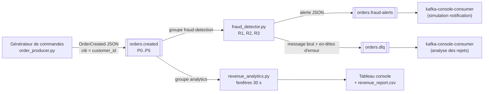

### 6.2 Modèle de données des événements

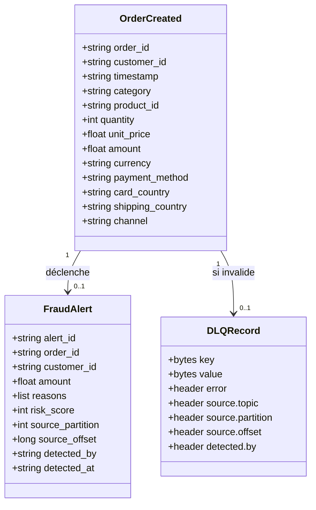

*Notes : `customer_id` est la clé Kafka des topics `orders.created` et `orders.fraud-alerts` ; `timestamp` est au format ISO 8601 UTC ; `order_id` est un UUID v4 ; la valeur d'un `DLQRecord` est le message brut d'origine, inchangé.*

Exemple d'événement `OrderCreated` :

```json
{
  "order_id": "8f1c2a0e-5b7d-4d8e-9a43-2f6c1e9b7a10",
  "customer_id": "C00427",
  "timestamp": "2026-11-22T21:14:03.512+00:00",
  "category": "electronique",
  "product_id": "P-ELEC-0213",
  "quantity": 2,
  "unit_price": 1249.90,
  "amount": 2499.80,
  "currency": "EUR",
  "payment_method": "card",
  "card_country": "CA",
  "shipping_country": "FR",
  "channel": "mobile"
}
```

### 6.3 Topologie de déploiement

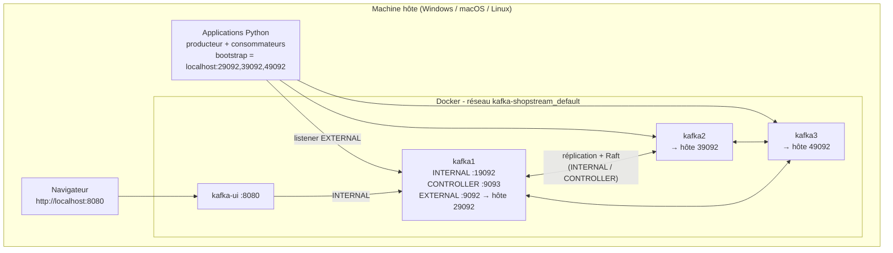

Chaque broker expose **trois listeners** :

- `INTERNAL` (port 19092) : trafic inter-brokers et clients à l'intérieur du réseau Docker (Kafka UI, outils CLI) ;
- `CONTROLLER` (port 9093) : trafic du quorum Raft ;
- `EXTERNAL` (port 9092 du conteneur, publié sur 29092/39092/49092) : clients exécutés sur la machine hôte. L'adresse annoncée (`advertised.listeners`) est `localhost:<port>`, ce qui permet aux clients de l'hôte de joindre directement le leader de chaque partition.

---

## 7. Environnement technique

### 7.1 Prérequis

| Logiciel | Version de référence | Vérification |
|---|---|---|
| Docker Desktop (ou Docker Engine + plugin Compose) | Docker ≥ 24, Compose v2 | `docker --version` ; `docker compose version` |
| Python | 3.11 à 3.13 | `python --version` |
| Ressources | 4 Go de RAM libres pour Docker, 2 Go de disque | Paramètres de Docker Desktop |
| Ports libres | 29092, 39092, 49092, 8080 | — |

### 7.2 Ressources du projet (dépôt GitHub)

L'ensemble du code source, des fichiers de configuration et des scripts est publié sur le dépôt :

**https://github.com/Ayib201/presentation-bigData**

Ce rapport ne reproduit pas le code : il en décrit la conception et renvoie aux fichiers du dépôt. Pour récupérer le projet :

```powershell
git clone https://github.com/Ayib201/presentation-bigData.git
cd presentation-bigData/kafka-shopstream
```

| Fichier du dépôt | Rôle |
|---|---|
| [`kafka-shopstream/docker-compose.yml`](https://github.com/Ayib201/presentation-bigData/blob/main/kafka-shopstream/docker-compose.yml) | Cluster Kafka 4.0 de 3 nœuds en mode KRaft + Kafka UI |
| [`kafka-shopstream/scripts/create-topics.sh`](https://github.com/Ayib201/presentation-bigData/blob/main/kafka-shopstream/scripts/create-topics.sh) | Création et configuration des topics `orders.created`, `orders.fraud-alerts`, `orders.dlq`, `perf.test` |
| [`kafka-shopstream/apps/requirements.txt`](https://github.com/Ayib201/presentation-bigData/blob/main/kafka-shopstream/apps/requirements.txt) | Dépendance Python (`confluent-kafka`) |
| [`kafka-shopstream/apps/config.py`](https://github.com/Ayib201/presentation-bigData/blob/main/kafka-shopstream/apps/config.py) | Paramètres communs (adresses des brokers, noms des topics, champs obligatoires) |
| [`kafka-shopstream/apps/order_producer.py`](https://github.com/Ayib201/presentation-bigData/blob/main/kafka-shopstream/apps/order_producer.py) | Producteur : simulation du service Commandes |
| [`kafka-shopstream/apps/fraud_detector.py`](https://github.com/Ayib201/presentation-bigData/blob/main/kafka-shopstream/apps/fraud_detector.py) | Consommateur : détection de fraude, alertes et DLQ |
| [`kafka-shopstream/apps/revenue_analytics.py`](https://github.com/Ayib201/presentation-bigData/blob/main/kafka-shopstream/apps/revenue_analytics.py) | Consommateur : chiffre d'affaires par fenêtres de 30 s |
| [`kafka-shopstream/README.md`](https://github.com/Ayib201/presentation-bigData/blob/main/kafka-shopstream/README.md) | Démarrage rapide |

### 7.3 Configuration du cluster (`docker-compose.yml`)

Le fichier déclare quatre conteneurs : `kafka1`, `kafka2`, `kafka3` (image officielle `apache/kafka:4.0.0`) et `kafka-ui`. Les paramètres communs aux trois nœuds sont factorisés dans une ancre YAML ; seuls l'identifiant de nœud et les listeners diffèrent d'un nœud à l'autre.

**Paramètres clés :**

| Paramètre | Valeur | Rôle |
|---|---|---|
| `KAFKA_PROCESS_ROLES` | `broker,controller` | Mode combiné : chaque nœud stocke des partitions **et** participe au quorum Raft |
| `KAFKA_NODE_ID` | 1, 2, 3 | Identifiant unique de chaque nœud |
| `KAFKA_CONTROLLER_QUORUM_VOTERS` | `1@kafka1:9093,2@kafka2:9093,3@kafka3:9093` | Membres votants du quorum de métadonnées (majorité = 2) |
| `KAFKA_LISTENERS` / `KAFKA_ADVERTISED_LISTENERS` | `INTERNAL :19092`, `CONTROLLER :9093`, `EXTERNAL :9092` annoncé `localhost:29092/39092/49092` | Séparation du trafic interne, du trafic Raft et des clients de la machine hôte |
| `CLUSTER_ID` | identifiant base64 | Identifiant unique du cluster, identique sur les 3 nœuds (le stockage est formaté automatiquement au premier démarrage par l'image officielle) |
| `KAFKA_DEFAULT_REPLICATION_FACTOR` | 3 | Facteur de réplication par défaut |
| `KAFKA_MIN_INSYNC_REPLICAS` | 2 | Nombre minimal de répliques synchrones pour accepter une écriture `acks=all` |
| `KAFKA_OFFSETS_TOPIC_REPLICATION_FACTOR` | 3 | Réplication du topic interne `__consumer_offsets` (sinon perte des positions des groupes en cas de panne) |
| `KAFKA_TRANSACTION_STATE_LOG_REPLICATION_FACTOR` / `_MIN_ISR` | 3 / 2 | Durabilité du journal des transactions (utilisé par les producteurs idempotents/transactionnels) |
| `KAFKA_AUTO_CREATE_TOPICS_ENABLE` | false | Interdit la création implicite de topics |
| `KAFKA_GROUP_INITIAL_REBALANCE_DELAY_MS` | 0 | Affectation immédiate des partitions au premier consommateur (confort de démonstration) |
| `KAFKA_LOG_RETENTION_HOURS` | 168 | Rétention par défaut : 7 jours |

Kafka UI est configuré avec le listener `INTERNAL` des trois brokers et accessible sur http://localhost:8080. Aucun volume persistant n'est déclaré : le laboratoire est réinitialisable.

### 7.4 Dimensionnement des topics (`scripts/create-topics.sh`)

| Topic | Partitions | RF | `min.insync.replicas` | Rétention | Usage |
|---|---|---|---|---|---|
| `orders.created` | 6 | 3 | 2 | 7 jours | Flux principal des commandes (clé = `customer_id`) |
| `orders.fraud-alerts` | 3 | 3 | 2 | 30 jours | Alertes produites par le détecteur de fraude |
| `orders.dlq` | 1 | 3 | 2 | 30 jours | Messages invalides, avec en-têtes de contexte |
| `perf.test` | 6 | 3 | 2 | défaut | Bancs d'essai de performance |

Le script est idempotent (`--if-not-exists`) et se termine par la liste des topics créés.

### 7.5 Conception des applications Python

Les trois programmes utilisent la bibliothèque `confluent-kafka` (client officiel de Confluent, fondé sur la bibliothèque C librdkafka).

**Producteur — `order_producer.py`**

- Génère des commandes réalistes : 5 catégories pondérées avec des fourchettes de prix propres, quantités de 1 à 4, 8 pays francophones, 50 000 clients, environ 5 % de cartes émises dans un autre pays que le pays de livraison.
- Injecte volontairement deux anomalies paramétrables : des **messages corrompus** (JSON tronqué, 1 % par défaut, option `--malformed`) et des **rafales** de 5 commandes d'un même client (1 % par défaut, option `--burst`) pour déclencher la règle de vélocité.
- Clé du message = `customer_id` ; configuration de fiabilité : `enable.idempotence=true`, `acks=all`, `compression.type=lz4`, `linger.ms=20`, `batch.size=65536`, `delivery.timeout.ms=120000`.
- Un *callback* de livraison compte les accusés et les erreurs, et mesure la répartition par partition ; la saturation du tampon local (`BufferError`) est gérée par une boucle d'attente.
- Options : `--rate` (commandes/s visées), `--count` (0 = infini).

**Détecteur de fraude — `fraud_detector.py`** (groupe `fraud-detection`)

- Règles : **R1** montant > 3 000 € ; **R2** pays de la carte ≠ pays de livraison et montant > 300 € ; **R3** au moins 4 commandes d'un même client en 60 s (fenêtre glissante en mémoire, valable car la clé garantit qu'un client est toujours traité par la même instance).
- Sémantique *at-least-once* : `enable.auto.commit=false` ; toutes les 200 commandes ou 5 s, le service attend l'acquittement de ses alertes et messages DLQ (`flush`), **puis** valide ses offsets (`commit` synchrone).
- Les messages illisibles ou incomplets sont republiés tels quels dans `orders.dlq`, avec des en-têtes `error`, `source.topic`, `source.partition`, `source.offset` et `detected.by`.
- Stratégie d'affectation `cooperative-sticky` ; *callbacks* `on_assign` / `on_revoke` qui affichent les partitions et valident les offsets avant de céder une partition ; `session.timeout.ms=10000`.
- Option `--instance` pour lancer plusieurs instances nommées (A, B, C…).

**Analytique — `revenue_analytics.py`** (groupe `analytics`)

- Agrège le nombre de commandes, le chiffre d'affaires par catégorie (avec panier moyen) et par pays dans des **fenêtres fixes** de 30 s (option `--window`), calées sur l'horodatage métier (*event time*).
- Une fenêtre est publiée lorsque le **watermark** — le minimum, sur les partitions assignées, du plus grand horodatage vu dans chacune — dépasse sa fin de 5 s (délai de grâce). Ce choix rend le calcul correct aussi bien en direct que lors d'un **rejeu** de l'historique, où les partitions sont relues à des vitesses différentes. Les événements arrivant après la publication de leur fenêtre sont comptés comme tardifs et écartés. Si le flux est inactif, l'horloge prend le relais pour publier la dernière fenêtre.
- Résultats affichés en console et ajoutés au fichier `revenue_report.csv`.
- Validation automatique des offsets (`enable.auto.commit=true`), choix de simplicité discuté dans les limites.

> **Note de validation.** Une première version fermait les fenêtres selon l'horloge murale ; le test de rejeu (étape 9) a montré qu'elle publiait alors une « fenêtre » par message (80 944 au lieu de 18). La version du dépôt utilise le watermark par partition décrit ci-dessus. Cet incident illustre concrètement la différence entre temps de traitement et temps d'événement en streaming.


## 8. Mise en œuvre pas à pas

> **Captures d'écran.** Les figures de cette partie proviennent de l'exécution réelle du protocole sur la machine de l'auteur. Les pages de Kafka UI sont des captures directes du navigateur. Les figures de terminal reproduisent les sorties réelles des commandes et des programmes (journaux conservés lors de l'exécution), mises en forme dans une fenêtre de terminal ; les lignes en gris italique commençant par `#` sont des annotations ajoutées pour situer les événements (horodatages issus de `docker events`).

> **Convention.** Les commandes `docker ...` et `python ...` sont exécutées sur la machine hôte (PowerShell sous Windows, terminal sous macOS/Linux), depuis le dossier `kafka-shopstream/`. Les commandes `kafka-*.sh` sont exécutées **dans** un conteneur via `docker exec`. Il est recommandé d'ouvrir **4 à 5 terminaux** côte à côte pour les étapes 5 à 8.

### Étape 1 — Démarrage du cluster

```powershell
cd kafka-shopstream
docker compose pull
docker compose up -d
docker compose ps
```

Attendre ~20 secondes, puis vérifier dans les journaux que chaque nœud a rejoint le quorum et démarré :

```powershell
docker logs kafka1 2>&1 | Select-String "Kafka Server started"
docker logs kafka1 2>&1 | Select-String -Pattern "leader" | Select-Object -Last 5
```

(Sous Linux/macOS : `docker logs kafka1 2>&1 | grep "Kafka Server started"`.)


*Figure 1 — Conteneurs du cluster en fonctionnement (`docker compose ps`) : 3 brokers et Kafka UI, ports 29092, 39092, 49092 et 8080 publiés.*


*Figure 2 — Démarrage du nœud 1 en mode KRaft (`Kafka Server started`).*

### Étape 2 — Vérification du quorum KRaft

```powershell
docker exec -it kafka1 /opt/kafka/bin/kafka-metadata-quorum.sh --bootstrap-server kafka1:19092 describe --status
docker exec -it kafka1 /opt/kafka/bin/kafka-metadata-quorum.sh --bootstrap-server kafka1:19092 describe --replication
```

**Résultat attendu** : `LeaderId` (contrôleur actif, l'un des nœuds 1, 2 ou 3), `CurrentVoters: [1,2,3]`, et pour chaque votant un `Lag` à 0 (ou très faible) dans la vue `--replication`.

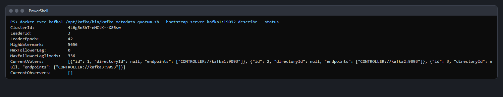

*Figure 3 — État du quorum KRaft : 3 votants, un contrôleur leader, retard des suiveurs nul.*

### Étape 3 — Création et inspection des topics

**Option A (script)** :

```powershell
Get-Content scripts/create-topics.sh -Raw | docker exec -i kafka1 bash
```

(Sous Linux/macOS : `docker exec -i kafka1 bash < scripts/create-topics.sh`.)

**Option B (commande par commande)**, par exemple pour le topic principal :

```powershell
docker exec -it kafka1 /opt/kafka/bin/kafka-topics.sh --bootstrap-server kafka1:19092 --create --topic orders.created --partitions 6 --replication-factor 3 --config min.insync.replicas=2 --config retention.ms=604800000
```

Inspection du topic principal :

```powershell
docker exec -it kafka1 /opt/kafka/bin/kafka-topics.sh --bootstrap-server kafka1:19092 --describe --topic orders.created
```

**Résultat obtenu** lors de la validation (les numéros de leaders peuvent différer d'une exécution à l'autre) :

```
Topic: orders.created  PartitionCount: 6  ReplicationFactor: 3  Configs: compression.type=producer,min.insync.replicas=2,retention.ms=604800000
  Topic: orders.created  Partition: 0  Leader: 1  Replicas: 1,2,3  Isr: 1,2,3  Elr:   LastKnownElr:
  Topic: orders.created  Partition: 1  Leader: 2  Replicas: 2,3,1  Isr: 2,3,1  Elr:   LastKnownElr:
  Topic: orders.created  Partition: 2  Leader: 3  Replicas: 3,1,2  Isr: 3,1,2  Elr:   LastKnownElr:
  Topic: orders.created  Partition: 3  Leader: 2  Replicas: 2,1,3  Isr: 2,1,3  Elr:   LastKnownElr:
  Topic: orders.created  Partition: 4  Leader: 1  Replicas: 1,3,2  Isr: 1,3,2  Elr:   LastKnownElr:
  Topic: orders.created  Partition: 5  Leader: 3  Replicas: 3,2,1  Isr: 3,2,1  Elr:   LastKnownElr:
```

On observe que **les leaders sont répartis équitablement** sur les 3 brokers (2 partitions leader chacun) et que l'ISR contient les 3 répliques. Les colonnes `Elr` / `LastKnownElr` (*Eligible Leader Replicas*, KIP-966) sont propres à Kafka 4.x ; elles sont vides tant que l'ISR est complet.

> Lors de la création, Kafka affiche un avertissement : les topics contenant un point (`.`) ou un tiret bas (`_`) peuvent entrer en collision dans les noms de métriques. Il est sans conséquence ici, car la convention adoptée n'utilise que le point (`domaine.événement`).


*Figure 4 — Topics créés par le script `create-topics.sh`.*


*Figure 5 — Description du topic `orders.created` : 6 partitions, 3 répliques, leaders répartis et ISR complet.*

Ouvrir ensuite **Kafka UI** à l'adresse http://localhost:8080 :

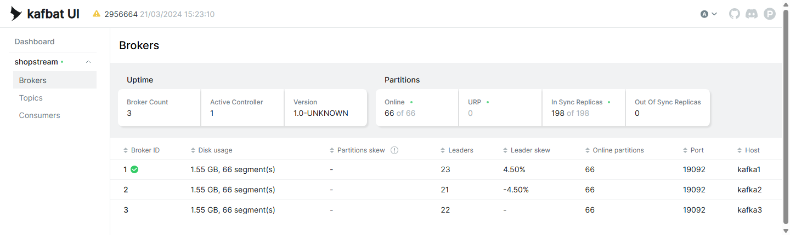

*Figure 6 — Kafka UI, page « Brokers » : 3 brokers en ligne, aucune partition sous-répliquée (URP = 0).*


*Figure 7 — Kafka UI, topic `orders.created` : 6 partitions, facteur de réplication 3, 18 répliques synchrones sur 18.*

### Étape 4 — Premier test publication/abonnement en ligne de commande

Ce test valide le fonctionnement de base demandé dans le PDF. Terminal 1 (consommateur) :

```powershell
docker exec -it kafka1 /opt/kafka/bin/kafka-console-consumer.sh --bootstrap-server kafka1:19092 --topic orders.created --from-beginning --property print.key=true --property print.partition=true --property print.offset=true
```

Terminal 2 (producteur, saisir des lignes `clé:valeur`) :

```powershell
docker exec -it kafka2 /opt/kafka/bin/kafka-console-producer.sh --bootstrap-server kafka2:19092 --topic orders.created --property parse.key=true --property key.separator=:
```

Saisir par exemple :

```
C00001:{"test":"message 1"}
C00001:{"test":"message 2"}
C00002:{"test":"message 3"}
```

**Résultat attendu** : les messages apparaissent instantanément dans le terminal 1 ; les deux messages de `C00001` sont dans **la même partition** avec des offsets consécutifs. Quitter les deux terminaux avec `Ctrl+C`.


*Figure 8 — Test publication/abonnement en console : les deux messages de la clé `C00001` arrivent dans la même partition, avec des offsets consécutifs (sortie du consommateur filtrée sur les 3 messages de test).*

> Ces messages de test ne respectent pas le schéma `OrderCreated` : ils seront logiquement envoyés en DLQ par le détecteur de fraude à l'étape 6 — ce qui constitue un premier test de robustesse.

### Étape 5 — Installation des clients Python

```powershell
cd apps
python -m venv .venv
.\.venv\Scripts\Activate.ps1
pip install -r requirements.txt
python -c "import confluent_kafka; print(confluent_kafka.version(), confluent_kafka.libversion())"
```

(Sous Linux/macOS : `source .venv/bin/activate`.) Si PowerShell refuse l'activation du venv, exécuter une fois `Set-ExecutionPolicy -Scope CurrentUser RemoteSigned` ou appeler directement `.\.venv\Scripts\python.exe`.

### Étape 6 — Exécution du pipeline complet (fan-out)

Ouvrir quatre terminaux dans `kafka-shopstream/apps` (venv activé).

**Terminal A — détecteur de fraude (instance A)** :

```powershell
python fraud_detector.py --instance A
```

**Terminal B — analytique** :

```powershell
python revenue_analytics.py --window 30
```

**Terminal C — visualisation des alertes** (simulation d'un service de notification) :

```powershell
docker exec -it kafka1 /opt/kafka/bin/kafka-console-consumer.sh --bootstrap-server kafka1:19092 --topic orders.fraud-alerts --property print.key=true --group notification-service
```

**Terminal D — producteur** (50 commandes/s pendant ~2 minutes) :

```powershell
python order_producer.py --rate 50 --count 6000
```

**Résultats attendus :**

- Producteur : bilan toutes les 5 s ; à la fin, `erreurs : 0`, `non livrés : 0`, et une **répartition par partition** relativement homogène sur les 6 partitions (le hachage des 50 000 clients se répartit uniformément).
- Détecteur de fraude : au démarrage, `+ partitions ASSIGNÉES : [0, 1, 2, 3, 4, 5]` (seule instance du groupe) ; puis des lignes `ALERTE ... HIGH_AMOUNT`, `GEO_MISMATCH`, `VELOCITY` ; des lignes `DLQ <- ...` pour les messages corrompus (~1 %) et les 3 messages de test de l'étape 4.
- Analytique : toutes les 30 s, un tableau par catégorie (l'électronique domine le CA, la mode domine en nombre de commandes) et le top 3 des pays.
- Terminal C : les alertes JSON apparaissent en temps réel.

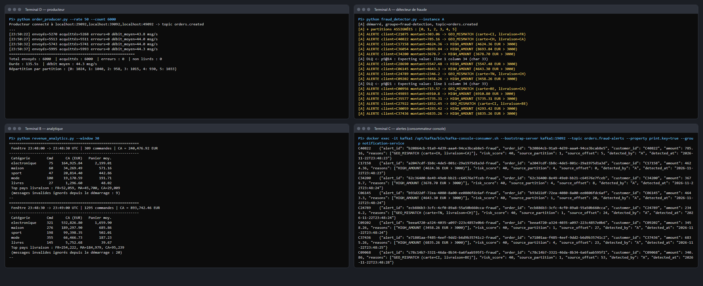

*Figure 9 — Pipeline complet en fonctionnement : producteur, détecteur de fraude (alertes et DLQ), analytique par fenêtres de 30 s et consommateur des alertes.*

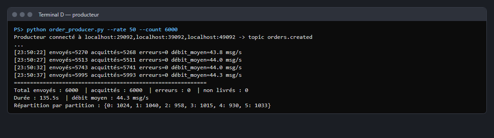

*Figure 10 — Bilan du producteur : 6 000 messages envoyés et acquittés, aucune erreur, répartition homogène sur les 6 partitions.*

> Note : le total acquitté peut légèrement dépasser `--count` car une rafale envoie 5 messages d'un coup ; le compteur `sent` est vérifié entre deux itérations. Le débit effectif peut aussi être un peu inférieur au débit visé (`--rate`), à cause de la granularité de `time.sleep` sous Windows (44 msg/s obtenus pour 50 visés lors de la validation).

> Au tout premier démarrage, des avertissements `Failed to acquire idempotence PID ... Coordinator load in progress: retrying` peuvent apparaître pendant quelques secondes : le coordinateur de transactions charge son topic interne. Ils sont transitoires et le client réessaie automatiquement.


*Figure 11 — Fenêtres de 30 s calculées par `revenue_analytics.py` : commandes, chiffre d'affaires et panier moyen par catégorie, top 3 des pays.*

Inspection de la DLQ (avec les en-têtes d'erreur). On remarque que tous les messages corrompus proviennent de la **même partition** (la partition 5 lors de la validation) : le producteur leur attribue la clé constante `CORRUPTED`, et le hachage de la clé les envoie donc tous vers la même partition — illustration directe du partitionnement par clé.

```powershell
docker exec -it kafka1 /opt/kafka/bin/kafka-console-consumer.sh --bootstrap-server kafka1:19092 --topic orders.dlq --from-beginning --property print.headers=true --property print.key=true --timeout-ms 5000
```


*Figure 12 — Contenu de la DLQ `orders.dlq` : message brut corrompu et en-têtes de contexte (erreur, partition et offset d'origine, instance).*

Visualisation dans Kafka UI d'un message réel :


*Figure 13 — Kafka UI, onglet « Messages » de `orders.created` : clé (`customer_id`), partition, offset, horodatage et contenu JSON d'une commande.*

**Preuve du modèle publication/abonnement** : lister les groupes et vérifier que chaque groupe a consommé l'intégralité du topic de façon indépendante :

```powershell
docker exec -it kafka1 /opt/kafka/bin/kafka-consumer-groups.sh --bootstrap-server kafka1:19092 --list
docker exec -it kafka1 /opt/kafka/bin/kafka-consumer-groups.sh --bootstrap-server kafka1:19092 --describe --group fraud-detection
docker exec -it kafka1 /opt/kafka/bin/kafka-consumer-groups.sh --bootstrap-server kafka1:19092 --describe --group analytics
```

**Résultat attendu** : pour les deux groupes, `CURRENT-OFFSET` égal (ou très proche) de `LOG-END-OFFSET` sur chaque partition, donc **`LAG` ≈ 0** : chaque groupe a reçu **tous** les messages.


*Figure 14 — Groupes `fraud-detection` et `analytics` : chaque groupe a lu l'intégralité du topic (LAG = 0 sur toutes les partitions).*

### Étape 7 — Scalabilité horizontale et rééquilibrage

1. Relancer le producteur en continu à un débit plus élevé (terminal D) :

   ```powershell
   python order_producer.py --rate 300
   ```

2. Le détecteur A tourne seul. Observer le lag (rafraîchir plusieurs fois) :

   ```powershell
   docker exec -it kafka1 /opt/kafka/bin/kafka-consumer-groups.sh --bootstrap-server kafka1:19092 --describe --group fraud-detection
   ```

3. Lancer une deuxième puis une troisième instance (nouveaux terminaux E et F) :

   ```powershell
   python fraud_detector.py --instance B
   ```

   ```powershell
   python fraud_detector.py --instance C
   ```

**Résultat attendu :**

- Lors de l'arrivée de B, le terminal A affiche `- partitions RÉVOQUÉES : [...]` (seulement une partie, grâce au protocole coopératif), et B affiche `+ partitions ASSIGNÉES : [...]`.
- Avec 3 instances, chacune détient **2 partitions**. La colonne `CONSUMER-ID` du `--describe` montre 3 identifiants distincts (`fraud-detector-A-...`, `-B-...`, `-C-...`).
- Arrêter B avec `Ctrl+C` : ses partitions sont **immédiatement** réattribuées à A et C (départ propre via `consumer.close()`).
- Tuer brutalement C (fermer la fenêtre du terminal) : la réattribution intervient après `session.timeout.ms` (10 s), le temps que le coordinateur constate l'absence de *heartbeat*.
- Bonus : lancer une 7ᵉ instance alors qu'il en existe déjà 6 → elle ne reçoit **aucune partition** (parallélisme borné par le nombre de partitions).

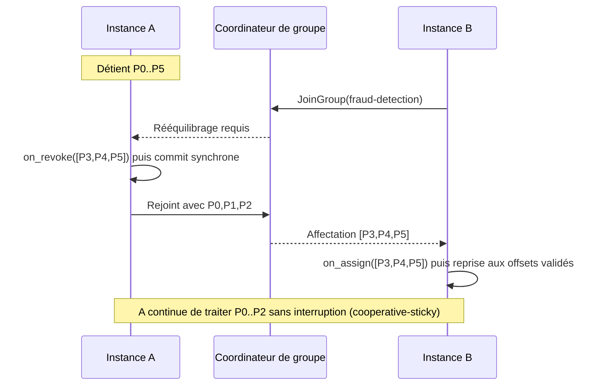

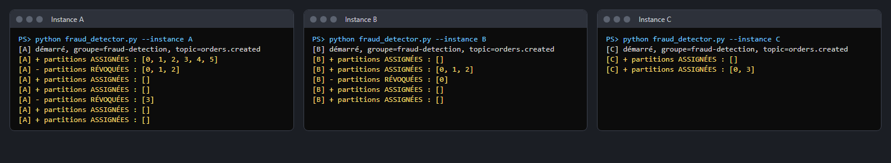

*Figure 15 — Rééquilibrage coopératif lors de l'arrivée des instances B puis C : seules les partitions qui changent de propriétaire sont révoquées. Les affectations vides correspondent aux étapes incrémentales du protocole coopératif.*


*Figure 16 — Groupe `fraud-detection` avec 3 instances : chacune détient 2 partitions ; le lag résiduel correspond aux commandes en cours de traitement (commit toutes les 200 commandes ou 5 s).*


*Figure 17 — Kafka UI, groupe `fraud-detection` : état STABLE, 3 membres, 6 partitions affectées.*

### Étape 8 — Tolérance aux pannes des brokers

Garder le producteur (`--rate 300`) et au moins une instance de détection en marche.

**8.1 — Identifier les leaders actuels :**

```powershell
docker exec -it kafka1 /opt/kafka/bin/kafka-topics.sh --bootstrap-server kafka1:19092 --describe --topic orders.created
```

**8.2 — Panne d'un broker** (ici kafka2) :

```powershell
docker stop kafka2
docker exec -it kafka1 /opt/kafka/bin/kafka-topics.sh --bootstrap-server kafka1:19092 --describe --topic orders.created
docker exec -it kafka1 /opt/kafka/bin/kafka-topics.sh --bootstrap-server kafka1:19092 --describe --under-replicated-partitions
```

**Résultat attendu :**

- les partitions dont kafka2 était leader ont un **nouveau leader** (1 ou 3) ;
- l'**ISR ne contient plus le broker 2** (ex. `Isr: 3,1`) ; les partitions apparaissent comme *under-replicated* ;
- le **producteur continue sans erreur** : l'ISR (2 répliques) satisfait `min.insync.replicas=2` ; on peut observer au plus quelques avertissements de reconnexion de librdkafka ;
- les consommateurs continuent de recevoir les messages ;
- `kafka-metadata-quorum.sh describe --status` montre que le quorum reste opérationnel (2 votants sur 3 = majorité).


*Figure 18 — Panne de `kafka2` : avant (ISR à 3 répliques) puis après l'arrêt (les partitions 1 et 3 changent de leader, ISR réduit à 1,3, partitions sous-répliquées).*


*Figure 19 — Producteur à 300 msg/s pendant la panne de `kafka2` : les acquittements continuent sans aucune erreur.*

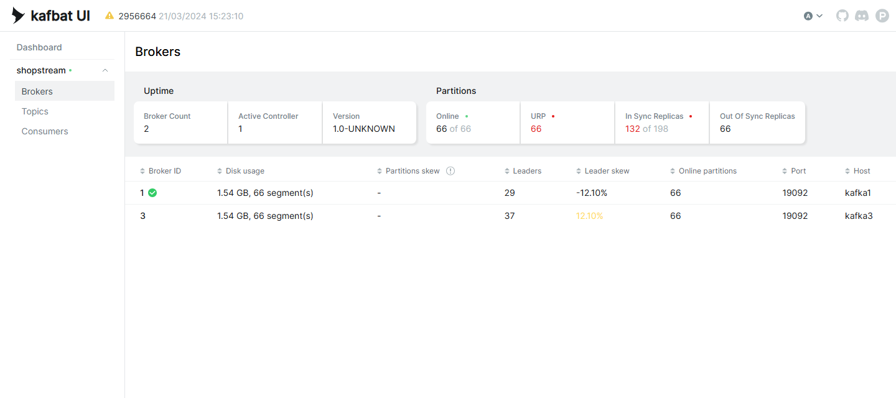

*Figure 20 — Kafka UI pendant la panne : 2 brokers sur 3, 66 partitions sous-répliquées (URP), 132 répliques synchrones sur 198.*

**8.3 — Panne d'un second broker** (perte de la majorité des répliques) :

```powershell
docker stop kafka3
```

**Résultat attendu** : il ne reste qu'une réplique ; l'ISR (1) est **inférieur à `min.insync.replicas` (2)**. Le broker restant refuse les écritures `acks=all` : le compteur `acquittés` du producteur cesse immédiatement de progresser. Le client idempotent réessaie en interne (le broker répond `NOT_ENOUGH_REPLICAS`), puis, une fois `delivery.timeout.ms` (120 s) épuisé, chaque message non acquitté remonte en erreur : `KafkaError{code=_MSG_TIMED_OUT,val=-192,str="Local: Message timed out"}`. Lors de la validation, environ 2 min 20 s de panne ont produit 12 225 échecs de livraison — autant de messages **qui n'ont pas été écrits**, et que le producteur sait ne pas avoir été écrits. De plus, avec un seul contrôleur sur trois, le **quorum KRaft est perdu** : aucun changement de métadonnées n'est possible. Kafka privilégie ici la **cohérence** sur la disponibilité (choix CP au sens du théorème CAP) : **aucune donnée n'est acquittée sans être répliquée**.


*Figure 21 — Perte de deux brokers : le compteur d'acquittements se fige, puis les messages non acquittés échouent (`Local: Message timed out`) à l'expiration de `delivery.timeout.ms`.*

**8.4 — Rétablissement :**

```powershell
docker start kafka3 kafka2
docker exec -it kafka1 /opt/kafka/bin/kafka-topics.sh --bootstrap-server kafka1:19092 --describe --topic orders.created
```

Après quelques secondes, l'ISR redevient complet (`Isr: x,y,z`). Les leaders peuvent rester déséquilibrés juste après le redémarrage ; Kafka les rééquilibre automatiquement vers les **répliques préférées** (`auto.leader.rebalance.enable=true`, vérification toutes les 5 minutes par défaut), ou immédiatement via :

```powershell
docker exec -it kafka1 /opt/kafka/bin/kafka-leader-election.sh --bootstrap-server kafka1:19092 --election-type PREFERRED --all-topic-partitions
```

Arrêter enfin le producteur (`Ctrl+C`) et **vérifier l'absence de perte** : le nombre total de messages acquittés par le producteur au fil des exécutions doit être inférieur ou égal à la somme des `LOG-END-OFFSET` du topic (égalité si aucun autre producteur n'a écrit) :

```powershell
docker exec -it kafka1 /opt/kafka/bin/kafka-get-offsets.sh --bootstrap-server kafka1:19092 --topic orders.created
```

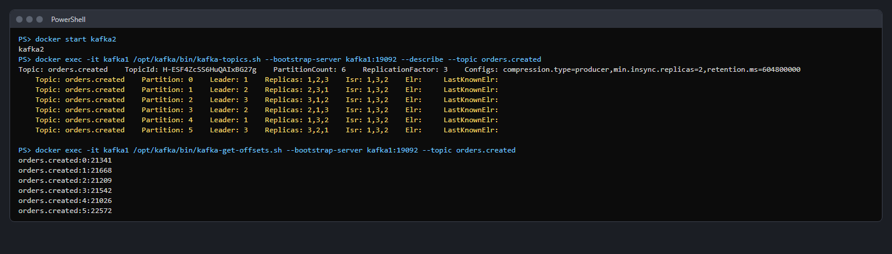

*Figure 22 — Après le redémarrage : ISR de nouveau complet sur les 6 partitions, et offsets de fin du topic.*

### Étape 9 — Rejouabilité : retraitement de l'historique

Kafka conservant les messages 7 jours, un groupe peut **relire le passé** — par exemple pour recalculer les statistiques après correction d'un bug.

1. Arrêter `revenue_analytics.py` (`Ctrl+C`) : un groupe doit être inactif pour qu'on modifie ses offsets.
2. Simuler, puis appliquer, la réinitialisation au début du topic :

```powershell
docker exec -it kafka1 /opt/kafka/bin/kafka-consumer-groups.sh --bootstrap-server kafka1:19092 --group analytics --topic orders.created --reset-offsets --to-earliest --dry-run
docker exec -it kafka1 /opt/kafka/bin/kafka-consumer-groups.sh --bootstrap-server kafka1:19092 --group analytics --topic orders.created --reset-offsets --to-earliest --execute
```

Variante temporelle (rejouer depuis une date précise, en UTC) :

```powershell
docker exec -it kafka1 /opt/kafka/bin/kafka-consumer-groups.sh --bootstrap-server kafka1:19092 --group analytics --topic orders.created --reset-offsets --to-datetime 2026-11-22T20:00:00.000 --execute
```

3. Relancer `python revenue_analytics.py --window 30` : toutes les fenêtres historiques sont recalculées et publiées en rafale, **sans aucun impact** sur le groupe `fraud-detection`, dont les offsets restent inchangés.


*Figure 23 — Réinitialisation des offsets du groupe `analytics` (`--dry-run` puis `--execute`) : le lag devient égal à la totalité du topic.*


*Figure 24 — Rejeu de l'historique : les fenêtres passées sont recalculées en rafale ; les offsets du groupe `fraud-detection` ne sont pas remis à zéro (groupe non affecté).*

### Étape 10 — Mesures de performance

Les outils de banc d'essai fournis avec Kafka sont exécutés depuis le conteneur `kafka1` sur le topic `perf.test` (6 partitions, RF = 3), avec des messages de **512 octets**. Les tests P1 à P3 envoient les messages **sans limitation de débit** (`--throughput -1`) pour mesurer le débit maximal ; dans ce mode, la latence affichée inclut surtout le temps d'attente dans le tampon du producteur saturé. Le test P4 mesure donc la **latence réelle** à débit maîtrisé.

**Test P1 — durabilité maximale (`acks=all`)** :

```powershell
docker exec -it kafka1 /opt/kafka/bin/kafka-producer-perf-test.sh --topic perf.test --num-records 1000000 --record-size 512 --throughput -1 --producer-props bootstrap.servers=kafka1:19092,kafka2:19092,kafka3:19092 acks=all linger.ms=10 batch.size=65536 compression.type=lz4
```

**Test P2 — durabilité réduite (`acks=1`)** :

```powershell
docker exec -it kafka1 /opt/kafka/bin/kafka-producer-perf-test.sh --topic perf.test --num-records 1000000 --record-size 512 --throughput -1 --producer-props bootstrap.servers=kafka1:19092,kafka2:19092,kafka3:19092 acks=1 linger.ms=10 batch.size=65536 compression.type=lz4
```

**Test P3 — sans batching (`linger.ms=0`, lots de 1 Ko, sans compression)** — limité à 100 000 messages, car ce mode est plus d'un ordre de grandeur plus lent (1 million de messages dépasse 10 minutes) :

```powershell
docker exec -it kafka1 /opt/kafka/bin/kafka-producer-perf-test.sh --topic perf.test --num-records 100000 --record-size 512 --throughput -1 --producer-props bootstrap.servers=kafka1:19092,kafka2:19092,kafka3:19092 acks=all linger.ms=0 batch.size=1024 compression.type=none
```

**Test P4 — latence à débit maîtrisé (2 000 msg/s, `acks=all`)** :

```powershell
docker exec -it kafka1 /opt/kafka/bin/kafka-producer-perf-test.sh --topic perf.test --num-records 100000 --record-size 512 --throughput 2000 --producer-props bootstrap.servers=kafka1:19092,kafka2:19092,kafka3:19092 acks=all linger.ms=10 batch.size=65536 compression.type=lz4
```

**Test C1 — débit de consommation** (relecture de 2 millions de messages) :

```powershell
docker exec -it kafka1 /opt/kafka/bin/kafka-consumer-perf-test.sh --bootstrap-server kafka1:19092 --topic perf.test --messages 2000000 --group perf-consumer --timeout 60000
```

Résultats obtenus lors de la validation (lignes finales des outils) :

```
P1  1000000 records sent, 15765.7 records/sec (7.70 MB/sec), 3114.78 ms avg latency, 21521.00 ms max latency, 1686 ms 50th, 13505 ms 95th, 19206 ms 99th, 21413 ms 99.9th.
P2  1000000 records sent, 12919.6 records/sec (6.31 MB/sec), 2422.30 ms avg latency, 13720.00 ms max latency, 432 ms 50th, 8364 ms 95th, 10725 ms 99th, 13670 ms 99.9th.
P3   100000 records sent,  1156.9 records/sec (0.56 MB/sec), 23943.18 ms avg latency, 33137.00 ms max latency, 26391 ms 50th, 31474 ms 95th, 32374 ms 99th, 33031 ms 99.9th.
P4   100000 records sent,  1998.9 records/sec (0.98 MB/sec), 9.08 ms avg latency, 932.00 ms max latency, 9 ms 50th, 14 ms 95th, 24 ms 99th, 57 ms 99.9th.
C1  data.consumed.in.MB=976.75  MB.sec=33.43  data.consumed.in.nMsg=2000384  nMsg.sec=68473.5
```

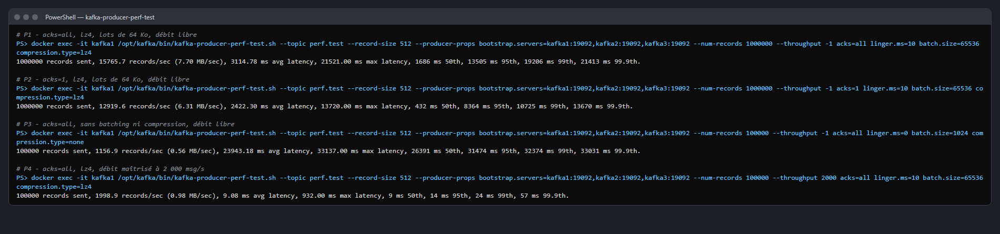

*Figure 25 — Résultats des bancs d'essai producteur P1 à P4.*

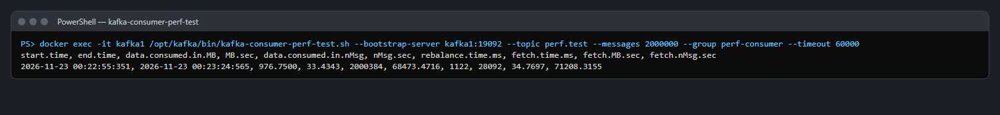

*Figure 26 — Résultat du banc d'essai consommateur C1.*

### Étape 11 — Arrêt et nettoyage

```powershell
docker compose down
```

`docker compose down` supprime les conteneurs et donc les données (aucun volume persistant n'est déclaré : choix volontaire pour un environnement de laboratoire réinitialisable). Utiliser `docker compose stop` / `docker compose start` pour conserver l'état entre deux séances.

---

## 9. Analyse des résultats

### 9.1 Résultats mesurés

Les valeurs ci-dessous ont été mesurées lors de l'exécution complète du protocole sur la machine de l'auteur (Windows 11, Docker Desktop limité à 8 Go de RAM, les 3 brokers partageant le même CPU et le même disque). Les performances absolues dépendent fortement du matériel ; ce sont les **comparaisons** entre configurations qui sont significatives.

| Expérience | Indicateur | Attendu | Mesuré |
|---|---|---|---|
| Étape 2 | Quorum KRaft | 3 votants, 1 leader | 3 votants, leader = nœud 2, lag des suiveurs = 0 |
| Étape 3 | Répartition des leaders de `orders.created` | équilibrée | 2 partitions leader par broker, ISR complet |
| Étape 6 | Messages produits / acquittés / en erreur | 6 000 / 6 000 / 0 | 6 000 / 6 000 / 0 (non livrés : 0) |
| Étape 6 | Répartition par partition | homogène | 930 à 1 040 messages par partition (écart max ≈ 11 %) |
| Étape 6 | Messages en DLQ | ≈ 1 % | 56 (0,9 %), tous dans la partition 5 (clé `CORRUPTED`) |
| Étape 6 | Alertes (toutes règles) | quelques % | 475 alertes (7,9 %) : 223 HIGH_AMOUNT, 143 GEO_MISMATCH, 127 VELOCITY |
| Étape 6 | Lag final des groupes `fraud-detection` et `analytics` | 0 | 0 sur les 6 partitions, pour les deux groupes |
| Étape 7 | Partitions par instance (1 → 2 → 3 instances) | 6 / 3-3 / 2-2-2 | 6 → 3-3 → 2-2-2, révocations partielles uniquement (coopératif) |
| Étape 8.2 | Erreurs producteur pendant la panne de 1 broker (300 msg/s visés) | 0 | 0 ; leaders basculés sur les brokers 1 et 3, ISR réduit à 2 |
| Étape 8.3 | Comportement avec 2 brokers arrêtés | écritures refusées | acquittements gelés, puis 12 225 échecs `_MSG_TIMED_OUT` après 120 s |
| Étape 8.4 | Rétablissement | ISR complet, leaders rééquilibrés | ISR 3/3 en moins de 30 s ; leaders rééquilibrés par élection PREFERRED |
| Étape 8.4 | Cohérence producteur / journal | aucune perte, aucun doublon | 81 713 messages dans le journal = 6 000 + messages acquittés ; les 12 225 échecs absents |
| Étape 9 | Rejeu du groupe `analytics` | toutes les fenêtres recalculées | 18 fenêtres, 80 944 commandes + 769 invalides = 81 713 (exactement la fin du journal), 0 événement tardif ; groupe `fraud-detection` inchangé (lag 0) |
| P1 (`acks=all`, lz4, lots 64 Ko) | Débit | — | 15 766 msg/s (7,7 Mo/s) |
| P2 (`acks=1`, lz4, lots 64 Ko) | Débit | ≥ P1 | 12 920 msg/s (6,3 Mo/s) |
| P3 (`acks=all`, sans batching ni compression) | Débit | ≪ P1 | 1 157 msg/s (0,56 Mo/s), soit 13,6 fois moins que P1 |
| P4 (`acks=all`, 2 000 msg/s) | Latence moyenne / p50 / p99 | quelques ms à dizaines de ms | 9,1 ms / 9 ms / 24 ms |
| C1 | Débit de consommation | > production | 68 473 msg/s (33,4 Mo/s), soit 4,3 fois P1 |

### 9.2 Interprétation

**Fiabilité de bout en bout.** L'absence d'erreurs de livraison à l'étape 6, la concordance entre les messages acquittés et les offsets de fin, et le lag nul des deux groupes démontrent que le couple *producteur idempotent + `acks=all`* côté écriture et *commit après traitement* côté lecture assure une chaîne **sans perte**. La DLQ prouve qu'un message invalide est isolé avec son contexte (partition, offset, erreur) **sans bloquer** la partition, ce qui est indispensable en production (un « poison pill » non géré provoquerait une boucle infinie de relecture).

**Découplage publication/abonnement.** Les groupes `fraud-detection`, `analytics` et `notification-service` lisent le même flux, chacun à son rythme, avec des offsets indépendants. Ajouter un nouvel abonné (ex. chargement HDFS/Hive) ne demande **aucune modification** du producteur : c'est l'apport architectural majeur par rapport à l'intégration point à point.

**Ordre et état local.** La clé `customer_id` garantit que toutes les commandes d'un client arrivent, dans l'ordre, à la même instance. C'est ce qui rend la règle de vélocité (R3) correcte **sans base de données partagée** entre instances. On observe en revanche qu'après un rééquilibrage, l'historique en mémoire d'une partition transférée est perdu : la nouvelle instance repart d'un état vide (voir limites).

**Scalabilité.** Le passage de 1 à 3 instances répartit les 6 partitions (2 par instance) et résorbe le lag lorsque le débit dépasse la capacité d'une seule instance. Le parallélisme est **borné par le nombre de partitions** : une 7ᵉ instance resterait inactive. Le dimensionnement du nombre de partitions est donc une décision prise **à la conception**, en anticipant le débit cible.

**Tolérance aux pannes et arbitrage CAP.** Avec RF = 3 et `min.insync.replicas` = 2 :

- la perte de **1 broker** est **transparente** (réélection de leaders, écritures et lectures continues) ;
- la perte de **2 brokers** entraîne le **refus des écritures** plutôt que l'acceptation de données non répliquées. Ce comportement est **voulu** : il illustre que Kafka, ainsi configuré, privilégie la cohérence (CP). Un système orienté disponibilité pourrait choisir `min.insync.replicas=1`, au prix d'un risque de perte.

**Performance.** Trois enseignements se dégagent des mesures :

- **Batching et compression sont déterminants.** P3 est 13,6 fois plus lent que P1 : sans regroupement, chaque message de 512 octets donne lieu à sa propre requête, répliquée sur deux suiveurs, et le coût fixe par requête domine. C'est la confirmation expérimentale du principe exposé au § 4.2.
- **`acks=1` n'a pas été plus rapide que `acks=all` sur cette machine** (12 920 contre 15 766 msg/s). Ce résultat contredit le modèle théorique, mais il s'explique : les trois brokers partagent le même CPU, le même disque et la même machine virtuelle Docker, si bien que le goulot d'étranglement est la ressource commune et non l'attente de réplication. L'écart entre deux exécutions relève alors du bruit de mesure. Sur un vrai cluster, où la réplication traverse le réseau, `acks=1` réduit sensiblement la latence. Ce point souligne la nécessité de **mesurer dans un environnement représentatif** avant de choisir un réglage.
- **Débit maximal et latence sont deux régimes différents.** À saturation (P1), la latence moyenne atteint plusieurs secondes, car les messages attendent dans le tampon du producteur. À débit maîtrisé (P4, 2 000 msg/s), la latence de bout en bout, réplication sur 2 répliques comprise, n'est que de **9 ms en moyenne et 24 ms au 99ᵉ centile**, conforme à l'objectif de « temps réel ».

La consommation (68 000 msg/s) est 4,3 fois plus rapide que la production : les lectures ne nécessitent ni réplication ni acquittement, et profitent du cache de pages et des lectures séquentielles. Les valeurs absolues restent nettement inférieures à celles d'un cluster réel où chaque broker dispose de ses propres ressources.

**Une leçon de streaming révélée par les tests.** La première version de l'analytique fermait ses fenêtres selon l'horloge murale ; lors du rejeu, elle a publié une « fenêtre » par message (80 944). Une deuxième version, fondée sur le plus grand horodatage observé, en a encore produit 58 005, car les partitions sont relues à des vitesses différentes et la plus rapide faisait avancer le temps pour toutes. La version finale calcule un **watermark par partition** (le minimum des partitions) et obtient les 18 fenêtres attendues. Ce problème est exactement celui que résolvent les mécanismes de *watermarks* de Spark Structured Streaming, Flink ou Kafka Streams.

**Rejouabilité.** L'étape 9 démontre la différence fondamentale entre Kafka et une file de messages classique : la lecture **ne consomme pas** la donnée. Le retraitement de l'historique est une simple opération sur les offsets d'un groupe, sans impact sur les autres.

---

## 10. Limites et bonnes pratiques

### 10.1 Limites du prototype

| Limite | Impact | Remédiation en production |
|---|---|---|
| Cluster sur une seule machine (Docker) | Pas de vraie indépendance des pannes (disque, réseau, alimentation communs) ; performances sous-estimées | Brokers sur machines/zones de disponibilité distinctes ; `broker.rack` pour répartir les répliques |
| Mode combiné broker + contrôleur | Charge des métadonnées partagée avec le trafic de données | 3 ou 5 contrôleurs dédiés |
| Aucune persistance de volume | Données perdues à `docker compose down` | Volumes persistants sur disques dédiés |
| Sécurité absente (PLAINTEXT) | Trafic en clair, pas d'authentification ni d'autorisation | TLS, SASL (SCRAM/OAuth), ACL par topic et par groupe |
| JSON sans schéma | Évolutions de format non contrôlées, messages volumineux | Schema Registry + Avro/Protobuf, règles de compatibilité |
| État de fraude en mémoire | Historique de vélocité perdu en cas de rééquilibrage ou de redémarrage | Kafka Streams / Flink avec state store sauvegardé dans un topic compacté (*changelog*), ou stockage externe (Redis, Cassandra) |
| *At-least-once* | Alertes en double possibles après un crash | Consommateurs idempotents (déduplication par `alert_id`) ou transactions Kafka (*exactly-once*) |
| Analytique avec auto-commit | Une fenêtre en cours peut être perdue en cas de crash (offsets validés avant la publication de la fenêtre) | Commit manuel après publication de la fenêtre, ou moteur de streaming (Spark Structured Streaming, Kafka Streams) avec checkpoints |
| Watermark artisanal | Les événements arrivant après la publication de leur fenêtre sont écartés ; une partition sans aucun message retarde la publication jusqu'au délai d'inactivité | *Watermarks*, sorties pour retardataires et état sauvegardé d'un moteur dédié (Spark Structured Streaming, Flink, Kafka Streams) |
| Supervision limitée à Kafka UI | Pas d'alerting automatique | Export JMX → Prometheus → Grafana ; alertes sur lag, partitions sous-répliquées, `OfflinePartitionsCount` |

### 10.2 Bonnes pratiques retenues

1. **Durabilité** : RF = 3, `min.insync.replicas` = 2, `acks=all`, producteur idempotent, `unclean.leader.election.enable=false` (valeur par défaut).
2. **Choix de la clé** : une clé métier stable assurant l'ordre là où il est nécessaire, et une distribution homogène (éviter les clés « chaudes » qui surchargent une partition).
3. **Dimensionnement des partitions** : partir du débit cible et du débit par consommateur (`partitions ≥ débit cible / débit par instance`), prévoir une marge ; augmenter le nombre de partitions plus tard modifie le mapping clé → partition.
4. **Commit après traitement** et traitements **idempotents** côté consommateur.
5. **Dead Letter Queue** systématique avec en-têtes de contexte et procédure de rejeu.
6. **Gouvernance des topics** : création explicite, conventions de nommage (`domaine.événement`), rétention adaptée au besoin de rejeu.
7. **Rééquilibrages maîtrisés** : stratégie `cooperative-sticky` (ou nouveau protocole KIP-848), `close()` propre des consommateurs, `max.poll.interval.ms` cohérent avec la durée de traitement.
8. **Observabilité** : le **lag** des groupes et le nombre de **partitions sous-répliquées** sont les deux indicateurs prioritaires.
9. **Réglage débit/latence** : ajuster `linger.ms`, `batch.size` et la compression (lz4/zstd) selon le profil voulu.

---

## 11. Conclusion générale

Ce travail a étudié Apache Kafka non comme une simple messagerie, mais comme un **journal distribué, partitionné et répliqué**, qui constitue aujourd'hui la colonne vertébrale des architectures Big Data temps réel.

Sur le plan **théorique**, nous avons montré comment des choix de conception simples — journal en ajout seul, E/S séquentielles, traitement par lots, partition comme unité de parallélisme et de réplication — répondent conjointement aux exigences de **débit**, de **volumétrie** et de **scalabilité**. Les mécanismes de **réplication par ISR**, de **consensus KRaft**, d'**idempotence** et de **gestion des offsets** apportent quant à eux la **tolérance aux pannes** et des **sémantiques de livraison** maîtrisées, dont l'arbitrage cohérence/disponibilité est explicitement configurable.

Sur le plan **pratique**, la plateforme ShopStream a permis de valider expérimentalement ces propriétés sur un cluster de 3 nœuds :

- un modèle **publication/abonnement** réel, où plusieurs services indépendants exploitent le même flux de commandes ;
- une chaîne **sans perte** grâce au producteur idempotent, à `acks=all` et au commit après traitement, avec une **DLQ** isolant les messages invalides ;
- une **scalabilité horizontale** par simple ajout d'instances, bornée par le nombre de partitions ;
- une **résilience** transparente à la perte d'un broker et un refus délibéré des écritures lorsque la durabilité ne peut plus être garantie ;
- la **rejouabilité** de l'historique, impossible avec une file de messages classique ;
- une **quantification** du compromis entre durabilité, débit et latence.

Ces résultats confirment que Kafka répond à la problématique posée, à condition de prendre au sérieux les décisions de conception (clé de partitionnement, nombre de partitions, paramètres de durabilité, sémantique de commit). Les limites identifiées tracent des **perspectives** naturelles : sécurisation du cluster (TLS, SASL, ACL), gouvernance des schémas (Schema Registry), traitement avec état tolérant aux pannes (Kafka Streams, Spark Structured Streaming ou Flink), sémantique *exactly-once* par transactions, persistance vers un entrepôt (Kafka Connect vers HDFS/Hive ou Cassandra) et supervision industrielle (Prometheus/Grafana). Kafka apparaît ainsi comme le point de convergence entre les différentes technologies étudiées dans ce module : il alimente les moteurs de traitement (Storm, Spark Streaming) et les systèmes de stockage (HDFS, Hive, Cassandra), et se substitue avantageusement aux outils de collecte spécialisés (Flume) dans les architectures modernes.

---

## Annexe A — Aide-mémoire des commandes

| Objectif | Commande (dans `kafka1`) |
|---|---|
| Lister les topics | `kafka-topics.sh --bootstrap-server kafka1:19092 --list` |
| Décrire un topic | `kafka-topics.sh --bootstrap-server kafka1:19092 --describe --topic <t>` |
| Partitions sous-répliquées | `kafka-topics.sh --bootstrap-server kafka1:19092 --describe --under-replicated-partitions` |
| Modifier une config de topic | `kafka-configs.sh --bootstrap-server kafka1:19092 --entity-type topics --entity-name <t> --alter --add-config retention.ms=86400000` |
| Lister / décrire les groupes | `kafka-consumer-groups.sh --bootstrap-server kafka1:19092 --list` / `--describe --group <g>` |
| Réinitialiser des offsets | `kafka-consumer-groups.sh ... --group <g> --topic <t> --reset-offsets --to-earliest --execute` |
| Offsets de fin | `kafka-get-offsets.sh --bootstrap-server kafka1:19092 --topic <t>` |
| État du quorum KRaft | `kafka-metadata-quorum.sh --bootstrap-server kafka1:19092 describe --status` |
| Élection des leaders préférés | `kafka-leader-election.sh --bootstrap-server kafka1:19092 --election-type PREFERRED --all-topic-partitions` |

(Préfixer chaque commande par `docker exec -it kafka1 /opt/kafka/bin/`.)

## Annexe B — Dépannage

| Symptôme | Cause probable | Solution |
|---|---|---|
| Client Python : `Connection refused` sur `localhost:29092` | Cluster non démarré ou port occupé | `docker compose ps` ; vérifier qu'aucun autre service n'utilise les ports |
| Client Python bloqué, journaux avec `kafka1:19092` introuvable | Client exécuté sur l'hôte mais configuré sur le listener INTERNAL | Utiliser `localhost:29092,localhost:39092,localhost:49092` (valeur par défaut de `config.py`) |
| `$'\r': command not found` en exécutant le script | Fins de ligne Windows (CRLF) | Convertir `create-topics.sh` en LF ou exécuter les commandes une à une |
| `Topic ... does not exist` côté producteur | Topics non créés (création automatique désactivée) | Exécuter l'étape 3 |
| `--reset-offsets` refusé (« consumer group is active ») | Des membres du groupe sont encore connectés | Arrêter tous les consommateurs du groupe, attendre ~10 s |
| Kafka UI vide au démarrage | Brokers pas encore prêts | Attendre 20-30 s puis recharger la page ; `docker restart kafka-ui` si nécessaire |
| Conteneurs qui redémarrent en boucle | RAM insuffisante allouée à Docker | Allouer au moins 4 Go dans Docker Desktop |

## Annexe C — Références

- Documentation officielle Apache Kafka 4.0 : https://kafka.apache.org/documentation/
- KIP-500 : *Replace ZooKeeper with a Self-Managed Metadata Quorum* (KRaft).
- KIP-98 : *Exactly Once Delivery and Transactional Messaging*.
- KIP-429 : *Kafka Consumer Incremental Rebalance Protocol* ; KIP-848 : *The Next Generation of the Consumer Rebalance Protocol*.
- J. Kreps, N. Narkhede, J. Rao, « Kafka: a Distributed Messaging System for Log Processing », NetDB Workshop, 2011.
- G. Shapira, T. Palino, R. Sivaram, K. Petty, *Kafka: The Definitive Guide*, 2ᵉ éd., O'Reilly, 2021.
- Documentation du client `confluent-kafka-python` : https://docs.confluent.io/platform/current/clients/confluent-kafka-python/
- Image Docker officielle : https://hub.docker.com/r/apache/kafka
