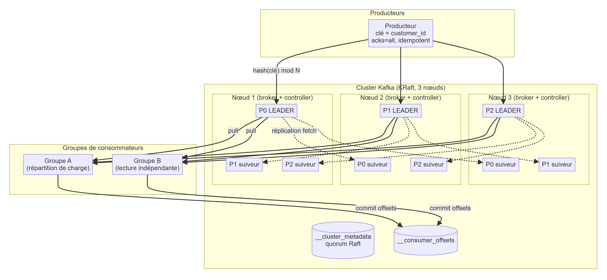
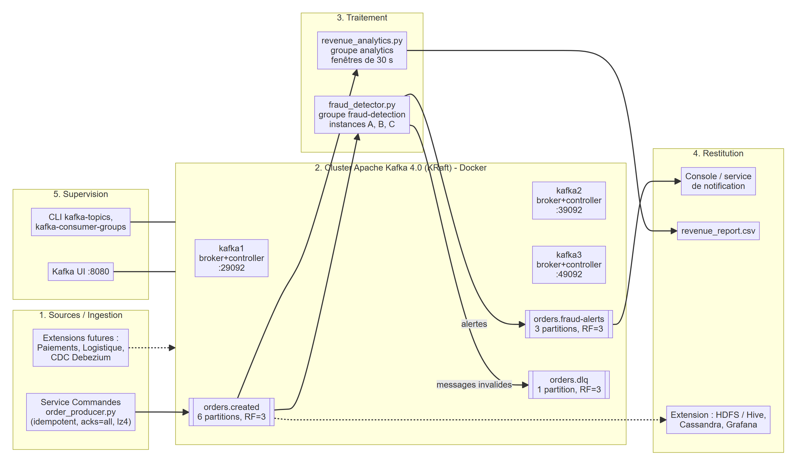
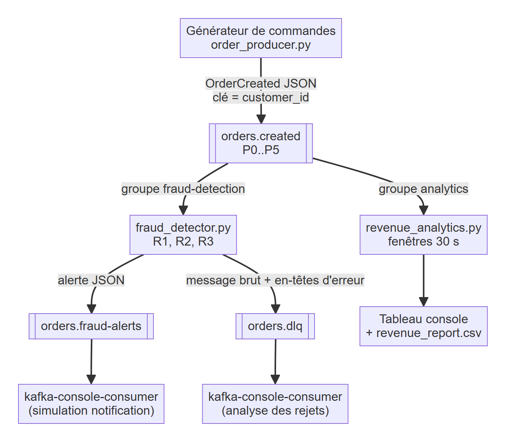
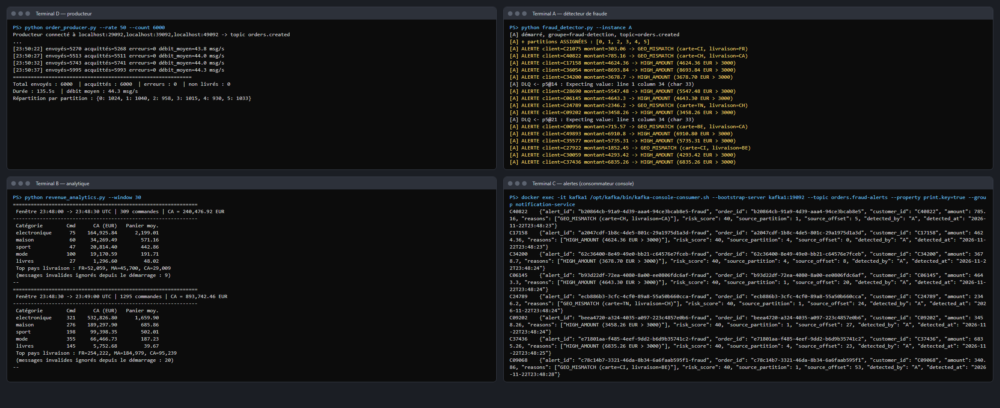
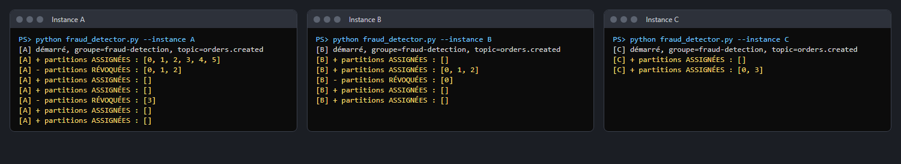
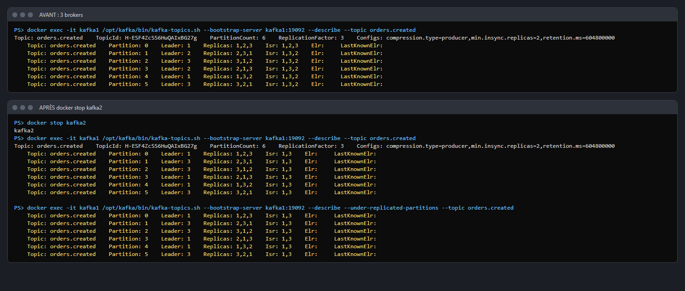
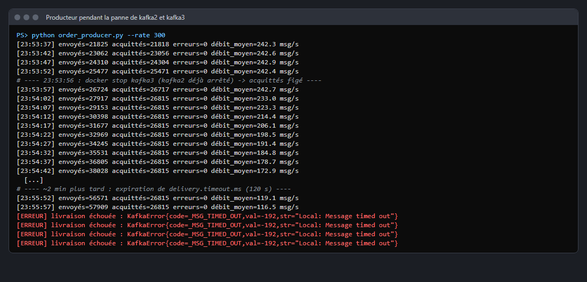

# Apache Kafka — Plateforme distribuée de streaming d'événements

## Système de publication/abonnement temps réel : le bus de commandes « ShopStream »

*Projet Big Data — Master Génie Logiciel*

---

## Avant-propos

Ce rapport traite le **sujet n°6 (Apache Kafka — système de publication/abonnement)**. Il suit le canevas demandé : une partie théorique (contexte, problématique, objectif, principe de fonctionnement, architecture) et une partie pratique. Le code, les configurations, les scripts, le protocole détaillé pas à pas et l'ensemble des 26 captures sont publiés sur le dépôt **https://github.com/Ayib201/presentation-bigData** ; ce document n'en retient que l'essentiel. Toutes les manipulations ont été exécutées et mesurées sur la machine de l'auteur (22-23 novembre 2026).

# PARTIE 1 : THÉORIQUE

## 1. Contexte

Les systèmes d'information ont longtemps traité la donnée **au repos** : les applications écrivent dans une base, puis des traitements par lots (ETL nocturnes, Hadoop MapReduce, Hive) l'analysent avec plusieurs heures de retard. Or de nombreux besoins exigent désormais de traiter la donnée **en mouvement** : bloquer une fraude avant l'expédition d'une commande, ajuster un stock, réagir à un capteur IoT.

Les approches traditionnelles s'y prêtent mal. L'**intégration point à point** couple fortement les applications (n × m connexions) et ne permet pas de rejouer l'historique ; l'**ETL batch** introduit une latence de plusieurs heures ; les **files de messages classiques** (JMS, RabbitMQ) suppriment le message après lecture et passent difficilement à l'échelle.

**Apache Kafka**, créé chez LinkedIn puis confié à la fondation Apache, répond à ce besoin. C'est une plateforme distribuée de streaming qui **publie**, **stocke durablement** et permet de **traiter** des flux d'événements. Dans une architecture Big Data, elle occupe la couche d'ingestion et de transport, entre les sources (applications, bases, capteurs, journaux) et les systèmes de traitement ou de stockage (Spark, Flink, HDFS/Hive, Cassandra). Depuis la version 4.0 (2025), Kafka gère ses métadonnées sans ZooKeeper, grâce à un consensus interne (**KRaft**).

## 2. Problématique

> **Comment transporter des flux massifs et continus d'événements avec une faible latence, sans perte, en résistant aux pannes de serveurs et en passant à l'échelle horizontalement, tout en permettant à plusieurs systèmes de consommer — et de rejouer — ces flux indépendamment ?**

| Défi | Tension à résoudre |
|---|---|
| Débit et latence | Regrouper les messages augmente le débit mais aussi la latence |
| Volumétrie | Conserver des jours de flux impose un stockage disque performant |
| Tolérance aux pannes | Répliquer de façon synchrone est sûr mais plus lent |
| Ordre et cohérence | Un ordre global est incompatible avec le parallélisme ; les réémissions créent des doublons |
| Scalabilité et découplage | Il faut une unité de parallélisme qui préserve l'ordre local et permette plusieurs lecteurs indépendants |

## 3. Objectif

**Objectif général :** comprendre le fonctionnement interne de Kafka et **démontrer expérimentalement**, sur un cluster distribué, qu'il constitue un bus d'événements fiable, performant et extensible.

**Objectifs spécifiques :**

1. Expliquer le modèle de Kafka (topics, partitions, offsets), la réplication (leader, ISR) et les garanties de livraison.
2. Déployer un cluster de 3 nœuds en mode KRaft et dimensionner ses topics.
3. Développer un producteur fiable et deux services consommateurs indépendants (publication/abonnement).
4. Prouver la scalabilité, la tolérance aux pannes et la rejouabilité, puis mesurer les performances.

## 4. Principe de fonctionnement

**Composants.** Des **producteurs** publient des enregistrements (clé, valeur, horodatage) dans des **topics**. Chaque topic est découpé en **partitions** : des journaux ordonnés, immuables, dans lesquels on ne fait qu'ajouter, et où chaque message reçoit un **offset** croissant. Les partitions sont réparties sur les **brokers** du cluster. Les **consommateurs** lisent ces journaux à leur rythme (modèle *pull*) ; les messages ne sont pas supprimés à la lecture mais conservés selon une durée de **rétention**.

**Partitionnement et ordre.** Le producteur choisit la partition par hachage de la clé (`hash(clé) mod N`) : tous les messages d'une même clé arrivent dans la même partition, ce qui **garantit leur ordre**. Kafka ne garantit l'ordre qu'au sein d'une partition ; la partition est aussi l'unité de parallélisme.

**Réplication et tolérance aux pannes.** Chaque partition possède un **leader**, qui reçoit les écritures, et des **suiveurs**, qui le recopient. L'**ISR** (*In-Sync Replicas*) regroupe les répliques à jour. Avec `acks=all`, le leader n'acquitte une écriture que lorsque toute l'ISR l'a reçue ; combiné à `min.insync.replicas=2`, cela garantit au moins deux copies de chaque message acquitté. Si un broker tombe, le contrôleur élit un nouveau leader parmi l'ISR et les clients basculent automatiquement. Le **producteur idempotent** numérote ses lots, ce qui permet au broker d'éliminer les doublons dus aux réémissions.

**Groupes de consommateurs.** Au sein d'un **groupe**, chaque partition est lue par un seul membre : la charge est répartie (modèle file). Deux groupes distincts reçoivent chacun la totalité du flux (modèle publication/abonnement). Chaque groupe enregistre sa position (**offset validé**) dans le topic interne `__consumer_offsets`. Valider après traitement donne la garantie *at-least-once* : aucune perte, mais des doublons possibles après un crash. Quand un membre arrive ou part, les partitions sont **rééquilibrées**.

**Performance.** Kafka écrit séquentiellement sur disque, s'appuie sur le cache de l'OS, transmet les données sans recopie (*zero-copy*) et traite les messages par lots compressés.

{width=100%}

*Figure 1 — Principe de fonctionnement : partitionnement par clé, leaders et suiveurs répartis sur 3 nœuds, lecture par groupes de consommateurs et validation des offsets.*

## 5. Architecture du système

Le système proposé, **ShopStream**, est le bus d'événements d'une plateforme e-commerce. Chaque commande créée est publiée dans Kafka ; plusieurs services s'y abonnent indépendamment, sans que le producteur les connaisse.

| Couche | Composants | Rôle |
|---|---|---|
| Ingestion | Service Commandes (`order_producer.py`) | Publier des événements fiables, clé = `customer_id` |
| Transport / stockage | Cluster Kafka 4.0, 3 nœuds KRaft ; topics `orders.created` (6 partitions, RF 3), `orders.fraud-alerts`, `orders.dlq` | Persistance répliquée, ordre par client, découplage |
| Traitement | Détection de fraude (groupe `fraud-detection`, N instances) ; analytique (groupe `analytics`) | Règles métier, agrégations par fenêtres de temps |
| Restitution | Alertes, rapport CSV ; extensions possibles : HDFS/Hive, Cassandra | Mise à disposition des résultats |
| Supervision | Kafka UI, outils en ligne de commande | Santé du cluster, retard (*lag*) des consommateurs |

{width=100%}

*Figure 2 — Architecture de ShopStream en cinq couches.*

**Choix de conception.** Un facteur de réplication de 3 avec `min.insync.replicas=2` permet de tolérer la perte d'un broker sans perte ni interruption. Les **6 partitions** autorisent jusqu'à 6 consommateurs parallèles par groupe. La **clé `customer_id`** garantit l'ordre des commandes d'un client. Une **file des messages invalides** (*Dead Letter Queue*, DLQ) isole les messages illisibles pour qu'ils ne bloquent pas le traitement.

# PARTIE 2 : PRATIQUE

## 6. Cas pratique et environnement

**Scénario.** Des commandes sont produites en continu (50 à 300 par seconde). Le service de fraude applique trois règles : **montant élevé** (plus de 3 000 €), **incohérence géographique** (pays de la carte différent du pays de livraison, au-delà de 300 €) et **vélocité** (au moins 4 commandes d'un même client en 60 s). Le service d'analytique calcule le chiffre d'affaires par fenêtres de 30 s. Environ 1 % de messages corrompus sont injectés volontairement pour tester la DLQ.

| Élément | Choix |
|---|---|
| Plateforme | Windows 11, Docker Desktop (8 Go de RAM) |
| Kafka | Apache Kafka 4.0.0, image officielle, mode KRaft, 3 nœuds (broker + contrôleur) |
| Supervision | Kafka UI (http://localhost:8080) |
| Clients | Python 3.13, bibliothèque `confluent-kafka` 2.16 |
| Fiabilité | Producteur idempotent, `acks=all`, compression lz4 ; consommateurs avec validation manuelle des offsets |

{width=62%}

*Figure 3 — Pipeline ShopStream : un producteur, deux groupes consommateurs indépendants, alertes et DLQ.*

## 7. Mise en œuvre

Le protocole complet (commandes exactes et sorties attendues) figure dans le dépôt ; le tableau ci-dessous en résume les étapes.

| Étape | Action | Commande principale |
|---|---|---|
| 1 | Démarrer le cluster | `docker compose up -d` |
| 2 | Créer et inspecter les topics | `create-topics.sh` puis `kafka-topics.sh --describe` |
| 3 | Lancer les services et le producteur | `fraud_detector.py`, `revenue_analytics.py`, `order_producer.py --rate 50 --count 6000` |
| 4 | Monter en charge | lancer les instances B et C du détecteur, puis `kafka-consumer-groups.sh --describe` |
| 5 | Simuler des pannes | `docker stop kafka2`, puis `docker stop kafka3`, puis redémarrage |
| 6 | Rejouer l'historique | `kafka-consumer-groups.sh --reset-offsets --to-earliest` |
| 7 | Mesurer les performances | `kafka-producer-perf-test.sh` et `kafka-consumer-perf-test.sh` |

**Déploiement et pipeline.** Les 3 nœuds forment un quorum KRaft opérationnel et les leaders des 6 partitions sont répartis équitablement (2 par broker). Sur 6 000 commandes produites, toutes ont été acquittées sans erreur ; le détecteur a émis 475 alertes et isolé 56 messages corrompus dans la DLQ.

{width=100%}

*Figure 4 — Pipeline en fonctionnement : producteur, détecteur de fraude (alertes, DLQ), analytique par fenêtres et consommateur des alertes.*

**Scalabilité.** L'ajout des instances B puis C répartit les 6 partitions (6, puis 3-3, puis 2-2-2). Grâce au protocole coopératif, seules les partitions qui changent de propriétaire sont révoquées : les autres continuent d'être traitées sans interruption.

{width=100%}

*Figure 5 — Rééquilibrage coopératif lors de l'arrivée des instances B et C.*

**Tolérance aux pannes.** À l'arrêt de `kafka2`, ses partitions basculent sur les brokers 1 et 3 et l'ISR passe à 2 répliques. Le producteur, à 300 messages/s, continue **sans aucune erreur**. À l'arrêt d'un second broker, il ne reste qu'une réplique, sous le seuil `min.insync.replicas=2` : Kafka **refuse les écritures** plutôt que de risquer une perte. Après 120 s, les messages non acquittés sont signalés en échec, et aucun n'a été écrit. Au redémarrage, l'ISR redevient complet.

{width=100%}

*Figure 6 — Avant et après l'arrêt de `kafka2` : nouveaux leaders et ISR réduit à deux répliques.*

{width=78%}

*Figure 7 — Perte de deux brokers : les acquittements se figent, puis les messages échouent à l'expiration du délai de livraison.*

**Rejouabilité.** La remise à zéro des offsets du groupe `analytics` recalcule toutes les fenêtres passées (80 944 commandes et 769 messages invalides, soit exactement le contenu du journal), sans affecter le groupe `fraud-detection`.

## 8. Analyse des résultats

| Expérience | Résultat mesuré |
|---|---|
| Pipeline (6 000 commandes) | 0 erreur ; 475 alertes (7,9 %) ; 56 messages en DLQ (0,9 %) ; retard nul pour les deux groupes |
| Montée en charge | 6 → 3-3 → 2-2-2 partitions par instance, sans interruption |
| Panne d'un broker | 0 erreur côté producteur ; bascule automatique des leaders |
| Panne de deux brokers | écritures refusées : 12 225 messages en échec, aucun écrit |
| Cohérence | 81 713 messages dans le journal = messages acquittés ; ni perte ni doublon |
| Débit de production (`acks=all`, lots, lz4) | 15 766 messages/s |
| Débit sans regroupement des messages | 1 157 messages/s (13,6 fois moins) |
| Latence à 2 000 messages/s | 9 ms en moyenne, 24 ms au 99ᵉ centile |
| Débit de consommation | 68 473 messages/s |

**Interprétation.**

- **Fiabilité.** L'association du producteur idempotent, de `acks=all` et de la validation après traitement donne une chaîne sans perte. La DLQ empêche un message invalide de bloquer sa partition.
- **Découplage.** Plusieurs groupes lisent le même flux à leur rythme ; on peut ajouter un abonné sans modifier le producteur.
- **Pannes et théorème CAP.** La perte d'un broker est transparente. Avec deux brokers perdus, Kafka privilégie la cohérence en refusant les écritures non répliquées : c'est un choix de configuration, `min.insync.replicas=1` donnerait la priorité à la disponibilité.
- **Performance.** Le regroupement des messages et la compression sont déterminants (facteur 13,6). Sur cette machine, `acks=1` n'a pas été plus rapide que `acks=all` : les trois brokers partageant le même processeur et le même disque, c'est cette ressource commune qui limite le débit, et non l'attente de réplication. Les valeurs absolues sont donc inférieures à celles d'un vrai cluster.
- **Leçon de streaming.** Le premier test de rejeu a révélé un défaut de l'analytique, qui fermait ses fenêtres selon l'heure courante (une « fenêtre » par message). La correction s'appuie sur un *watermark* par partition, c'est-à-dire sur le temps des événements, exactement comme les moteurs Spark Structured Streaming ou Flink.

## 9. Limites et bonnes pratiques

**Limites du prototype :** cluster sur une seule machine (pannes non indépendantes, performances sous-estimées), communications non chiffrées et sans authentification, messages JSON sans registre de schémas, état de la détection de fraude conservé en mémoire (perdu lors d'un rééquilibrage), garantie *at-least-once* (alertes en double possibles après un crash).

**Bonnes pratiques retenues :** facteur de réplication 3 avec `min.insync.replicas=2` et `acks=all` ; une clé métier stable pour l'ordre ; un nombre de partitions dimensionné selon le débit cible ; validation des offsets après traitement et traitements idempotents ; DLQ systématique ; surveillance du retard des consommateurs et des partitions sous-répliquées. En production, on ajouterait TLS et des listes de contrôle d'accès, un registre de schémas (Avro), un moteur de traitement avec état (Kafka Streams, Flink) et une supervision Prometheus/Grafana.

## 10. Conclusion

Kafka n'est pas une simple messagerie mais un **journal distribué, partitionné et répliqué**. Des choix simples (ajout seul, écriture séquentielle, regroupement des messages, partition comme unité de parallélisme et de réplication) répondent aux exigences de débit et de scalabilité. L'ISR, le consensus KRaft, l'idempotence et la gestion des offsets assurent la tolérance aux pannes et des garanties de livraison maîtrisées.

Le cas ShopStream l'a vérifié expérimentalement sur un cluster de 3 nœuds : publication/abonnement entre services indépendants, chaîne sans perte, montée en charge par simple ajout d'instances, résilience à la perte d'un broker, refus délibéré des écritures quand la durabilité n'est plus garantie, et rejeu de l'historique. Kafka apparaît ainsi comme le point de convergence des technologies du module : il alimente les moteurs de traitement (Storm, Spark Streaming) et les systèmes de stockage (HDFS, Hive, Cassandra).

## Références

- Documentation Apache Kafka 4.0 : https://kafka.apache.org/documentation/
- J. Kreps, N. Narkhede, J. Rao, « Kafka: a Distributed Messaging System for Log Processing », NetDB, 2011.
- G. Shapira et al., *Kafka: The Definitive Guide*, 2ᵉ éd., O'Reilly, 2021.
- KIP-500 (KRaft), KIP-98 (exactly-once), KIP-848 (nouveau protocole des groupes de consommateurs).
- Dépôt du projet : https://github.com/Ayib201/presentation-bigData
